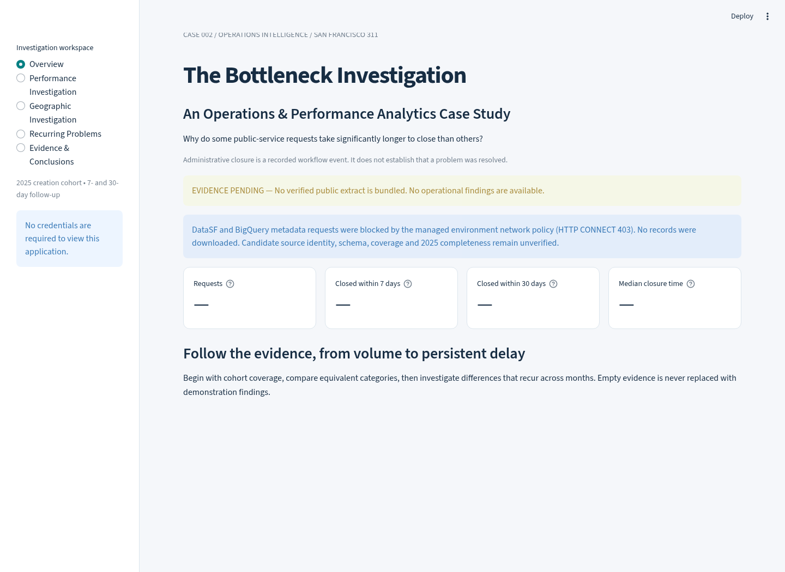

# The Bottleneck Investigation

**An Operations & Performance Analytics Case Study · Case 002**

Why do some public-service requests take significantly longer to resolve than others? This Streamlit investigation examines administrative closure, with explicit limits on what those records establish. Five workspaces cover overview, performance, geography, recurring problems and evidence-backed investigation briefs.

**Current release: evidence pending.** Neither candidate source's live schema or coverage could be verified because the development environment blocks the hosts. No public records, real metrics or San Francisco findings are fabricated. The application is usable in this state, showing the evidence ledger and investigation methodology. Baltimore D001–D007 material is methodological background only.



## Run locally

Python 3.11 or 3.12, from the repository root:

```bash
cd bottleneck-investigation
python -m venv .venv
source .venv/bin/activate
python -m pip install -r requirements-dev.txt
python -m pytest -q
python -m streamlit run app.py
```

Run production with `requirements.txt`; dev requirements add pytest, DuckDB SQL parity tests and Playwright. The app resolves data relative to its own file. No secrets, Google login, paid cloud resource or live API connection is needed for visitors.

## Refresh authentic evidence

1. Allow HTTPS access to `data.sfgov.org`. For optional BigQuery metadata inspection, allow `bigquery.googleapis.com`; no GCP identity is configured here. Do not provision billing.
2. Inspect `https://data.sfgov.org/api/views/vw6y-z8j6.json`. Confirm official dataset identity, public accessibility, actual field definitions and availability of 2025 records. The ID and mapping in `src/ingest.py` are **candidate configuration, not a verified schema**. If different, revise mapping deliberately and update the dictionary/tests. Never substitute unlabeled synthetic records.
3. From this project directory run `python -m src.ingest`. This retrieves only mapped fields for requests created in local calendar year 2025. Pages use deterministic request-ID ordering. All records must fit development memory; this command is not run by visitors. Retry failed mutable-source snapshots; do not bypass checks.
4. Review `data/provenance.json`: source URL, extraction start/end, as-of, observed columns, mapping, before/after source counts, update marker, quality results and coverage limitations. Counts must reconcile; missing/duplicate IDs or invalid cohort timestamps stop publication. Review nonblocking quality issues too.
5. Run `python -m pytest -q`, inspect all dashboard workspaces with the real bundle, and confirm `cube.parquet` is compact (target <25 MB). Do not commit raw records. If aggregates exceed the target, revise storage deliberately and preserve filter/quantile semantics.
6. Commit the cube and provenance together on a feature branch; submit a PR. Hash mismatch or interrupted publication causes a visible evidence-unavailable state. Do not claim completeness beyond the source-count reconciliation checks.

`sql/verify_bigquery.sql` is an unexecuted metadata inspection template. No unverified source-field analysis query is supplied. `sql/cohort_aggregates.sql` is executable DuckDB SQL over the documented normalized schema and is tested against Python.

## Streamlit Community Cloud deployment

| Setting | Exact value |
|---|---|
| Repository | `patelkavitarepo/Data-analytics-portfolio` |
| Branch for review deployment | `feat/case-002-streamlit` |
| Main file path | `bottleneck-investigation/app.py` |
| Python | `3.12` (3.11 also supported by CI) |
| Dependency file | `bottleneck-investigation/requirements.txt` (auto-detected beside app) |
| Secrets / environment variables | None |

Sign in to Streamlit Community Cloud with GitHub, select **Create app → Deploy a public app from GitHub**, enter those settings, choose Python 3.12 in Advanced settings, and deploy. Repository authorization or app publication may require your account action. Verify the resulting HTTPS URL and all five workspaces before describing it as deployed. This release will show evidence pending until a verified bundle is committed.

After approved merge, change the deployment branch to `main` or create a main-based app. Updates to the selected branch trigger a rebuild; inspect logs and the evidence ledger after each update. For data updates, run the refresh/review/test/PR steps above; no scheduled cloud ingestion or credentials are required. Do not merge without owner approval.

## Interpretation and structure

Closure rates use eligible cohorts and retain unresolved cases. Closed-case quantiles are approximate day bins and are subject to censoring bias. Category-adjusted agency comparisons require peer overlap and sufficient sample sizes. Persistence screens are investigative signals, never proof of process failure. See [DATA_DICTIONARY.md](DATA_DICTIONARY.md), [DECISIONS.md](DECISIONS.md) and [QA.md](QA.md).

- `src/`: acquisition, normalization, quality checks, analytics and bundle integrity
- `data/`: provenance plus compact verified aggregates when available
- `sql/`: normalized-schema parity SQL and optional metadata inspection
- `tests/`: deterministic synthetic **test-only** fixtures, cohort/quality/SQL/UI checks
- `app.py`: cached, filterable five-section dashboard

No modifications to `optiver-realized-volatility` are required.
