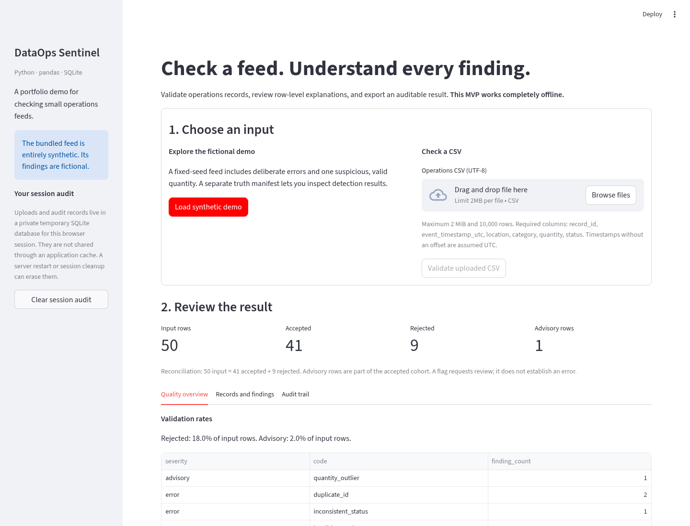
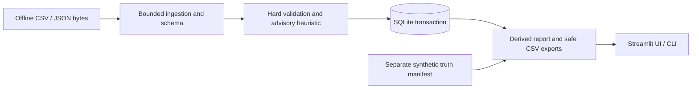

# DataOps Sentinel

An offline Python and Streamlit portfolio MVP that validates a fictional operations
feed, explains each finding, and keeps a transactional SQLite audit. It demonstrates
general programming and data engineering. All bundled data and findings are
**synthetic**; this is an educational project, not a commercial or production platform.

For the temporary feature-branch preview, start with
[Checkpoint 4 status](docs/CHECKPOINT_4_PREVIEW.md),
[iPad deployment steps](docs/PREVIEW_IPAD.md), and the
[browser-only acceptance walkthrough](docs/BROWSER_ACCEPTANCE.md).
The owner authorized a synthetic-only preview; deployment access is currently
blocked. Human acceptance, merge and production publication remain pending.

For the earlier local handoff, use the [owner acceptance walkthrough](docs/OWNER_ACCEPTANCE.md),
[Checkpoint 3 verification](docs/CHECKPOINT_3_RESULTS.md),
[deployment readiness](docs/DEPLOYMENT_READINESS.md), and
[career-fair brief](docs/PORTFOLIO_BRIEF.md).

## Run locally

Use Python **3.11 or 3.12**. From the repository root on Linux/macOS:

```bash
python3.12 -m venv dataops-sentinel/.venv
source dataops-sentinel/.venv/bin/activate
python -m pip install -r dataops-sentinel/requirements-dev.txt
python -m pytest -q dataops-sentinel/tests
python -m ruff check dataops-sentinel
cd dataops-sentinel
streamlit run streamlit_app.py
```

On Windows, activate with `dataops-sentinel\.venv\Scripts\Activate.ps1` in PowerShell.
For app-only use, install `requirements.txt`. Primary runtime and test dependencies
are pinned; transitive dependencies resolve through pip. No credentials or external
API are needed. Dependency installation requires network access; the running demo does not.

Click **Load synthetic demo**, inspect the records and findings, and download the
JSON quality report and accepted CSV. Click again to see an unchanged saved run.
Local configuration in `.streamlit/config.toml` caps uploads at 2 MiB and disables
usage telemetry. An equivalent launch from the repository root is:

```bash
streamlit run dataops-sentinel/streamlit_app.py --server.maxUploadSize=2 --browser.gatherUsageStats=false
```

## Working example and measured evidence

The committed [CSV](data/synthetic_operations.csv) has 50 rows. Its independent
[truth manifest](data/truth_manifest.json) enumerates every row; it is never used
by validation to decide findings. [Data provenance](docs/DATA_PROVENANCE.md)
lists every deliberate change, the fixed seed, and the exact SHA-256.

```csv
record_id,event_timestamp_utc,location,category,quantity,status
SYN-0050,2026-01-05T21:15:00Z,Synthetic Hub Cobalt,support,500,completed
```

The excerpt's field values are from the committed fixture. In a **fresh audit**:

| Result | Observed count | Denominator |
| --- | ---: | --- |
| Input | 50 | All data rows, excluding header |
| Accepted | 41 | 50 input rows (82%) |
| Rejected | 9 | 50 input rows (18%) |
| Advisory | 1 | 50 input rows (2%); also 1/41 accepted rows |

**50 = 41 + 9.** The advisory remains accepted. Hard failures are data rows 41–49;
row 50 is advisory only. Fresh-fixture evaluation gives hard errors TP=9, FP=0,
FN=0, TN=41; advisories TP=1, FP=0, FN=0, TN=49. These describe this constructed
example and do not estimate real-world accuracy. Prior accepted IDs change the
validation context; clear the session audit to use the demo truth evaluation.

See the [adversarial review and current results](docs/ADVERSARIAL_REVIEW.md),
[original build results](docs/TEST_RESULTS.md), and generated
[current quality report](docs/review_quality_report.json). The report contains
an actual run identifier and timestamp; those metadata change in a fresh database.



[Mobile screenshot](docs/mobile-demo.png)

## Architecture and rules



- `schema.py`: six required columns, resource limits, rule version.
- `ingestion.py`: UTF-8 CSV/JSON, normalized headers, format/schema feedback,
  SHA-256 of original bytes. Maximum **2 MiB / 10,000 rows / 131,072 decoded
  characters per field or column name**; missing/extra columns, collisions,
  malformed quoting/ragged rows, and empty input fail before auditing. JSON number
  tokens retain their exact text before Decimal validation; decoded NUL and invalid
  Unicode surrogates fail with actionable errors. Ingestion never changes Python's
  process-global CSV parser limit; a lower inherited limit can reject a CSV field.
- `validation.py`: required nonblank fields; duplicate IDs; ISO date/time with
  seconds and up to six fractional digits; finite integer quantity **0–10,000**;
  category `delivery/maintenance/support`; status `pending/completed/cancelled`.
  Cancelled requires quantity zero; other statuses require positive quantity.
  Headers and surrounding value whitespace normalize; IDs and vocabulary are
  case sensitive. Naive timestamps **assume UTC**; numeric offsets normalize to UTC.
- Advisory quantity score: `0.6745 * abs(quantity - median) / max(MAD, 1) > 3.5`,
  computed only on otherwise accepted rows when there are at least eight.
  A heuristic flag requests review; it never rejects a row or proves an error.
- `repository.py`: `sources`, `runs`, `accepted_rows`, `rejected_rows`, `findings`.
  Parameterized SQL, uniqueness/check constraints, `BEGIN IMMEDIATE`, full rollback,
  and closed connections. The rejected payload is retained with row-level reasons.
- `reporting.py`: rates with explicit denominators, per-reason unique row counts,
  separate hard-error/advisory confusion tables, SHA-bound complete truth labels.
  CSV exports prefix formula-like text for spreadsheet safety; stored values stay
  unchanged. Such sanitized exports can differ from the original ID text.

Exact bytes + rule version reuse the original audit, including original source
name and timestamp. A renamed identical file reuses it. A reformatted file has
a new hash. Every member of a duplicate-ID group within a file is rejected;
IDs already accepted by this database are rejected in later different files.
Rejected IDs are not reserved. This MVP has no record-update/overwrite semantics.
Current interpretation rules are version **2**. A database with runs under another
version is refused for new ingestion, preserving its history for inspection; use
a fresh database or clear the app's session audit. This prevents old rounded JSON
results from being reused after the precision fix. There is no migration tool.
Run metadata are intentionally time/UUID based; fixture decisions are deterministic
given the same input, rules, and prior audit state.

The JSON adapter accepts a flat array with the same schema. `fetch_json(fetcher)`
calls one injected response provider; tests mock successful, HTTP-error and offline
responses. There is **no built-in live HTTP client or network collection**. A future
real transport would need its own verified source permission, timeout and download
bound before supplying bytes.

## CLI and replay

From `dataops-sentinel/` with the virtual environment active:

```bash
mkdir -p .local-demo
python -m sentinel data/synthetic_operations.csv --db .local-demo/audit.sqlite3 --truth data/truth_manifest.json --report .local-demo/quality.json --clean .local-demo/accepted.csv
python -m sentinel data/synthetic_operations.csv --db .local-demo/audit.sqlite3 --truth data/truth_manifest.json
```

The second command returns the same `run_id` and `reused: true`; database totals
stay at one source, one run, 41 accepted rows, nine rejected rows and ten findings.
Use `--format json` for local JSON. Invalid input exits with code 2 and actionable
feedback. A report/export failure after the audit commits leaves that audit intact;
the error identifies the saved run and an exact-input retry safely reuses it.
Export paths must differ from input, truth, database and each other.
Existing hardlink/symlink aliases are checked too. SQLite's `-journal`, `-wal` and
`-shm` companion paths are reserved. External truth files share the 2 MiB bound;
malformed/deep JSON produces feedback before audit creation. The CLI assumes
the local user controls the filesystem; it is not a hostile multi-user file service.

Regenerate the fixture with `python -m sentinel.synthetic --output-dir data`.
No changing timestamp or network response enters the fixture generator.

## Streamlit Community Cloud instructions — after merge, not deployed here

1. After human review and merge, create an app at Streamlit Community Cloud using
   repository `patelkavitarepo/Data-analytics-portfolio`, branch **main**, and main
   file path **`dataops-sentinel/streamlit_app.py`**.
2. In advanced settings select Python **3.12**. The app-directory
   `dataops-sentinel/requirements.txt` supplies runtime dependencies. No secrets,
   API keys, database service, scheduled job or paid service are required.
3. Start the app and use the synthetic demo. Confirm 50/41/9/1, rerun reuse, and
   both downloads. Cloud hosting has not been verified by this implementation.
4. Keep the demo audience and retention requirements appropriate for a portfolio.
   Each browser session creates its own temporary SQLite directory; there is no
   globally cached upload dataset. Files can disappear on session cleanup/server
   restart. Download reports before leaving; this is not durable audit storage.

Community Cloud may launch from the repository root, so the nested
`.streamlit/config.toml` may not set its transport upload limit or telemetry there.
The parser still rejects anything above 2 MiB/10,000 rows. Configure the host's
`server.maxUploadSize=2` when supported; the tested local launch sets it explicitly.
No repository-root Streamlit configuration was added because the issue restricts
changes to this project. A hosted demo should use synthetic inputs only; do not
upload sensitive data. Session isolation is not authentication or an access-control
system, and this project makes no hosted security certification.

## Limitations and authorship

SQLite is local and single-instance; there is no shared durable store, retention
policy, scheduler, authentication, rule editor, migration system or background API
fetch. Per-input bounds do not impose a total session-storage quota. Format/schema
failures produce feedback before a run is created. Outlier detection is batch based,
can miss anomalies, and can flag legitimate values. Only the deliberately constructed
fixture has truth labels. CI targets Python 3.11/3.12; local results identify the
version actually executed. No release, merge, or deployment was performed.

SQLite session isolation is separate from Streamlit's download transport. A person
who knows an active media/download URL can retrieve it from another browser session.
URLs can remain available during framework cleanup after a failed submission or
session change; clearing the UI is not a guaranteed immediate link-revocation API.
Use fictional, non-sensitive inputs only. Sensitive-data hosting would require
authenticated access and a verified download/retention design outside this MVP.
Successful results show their source; failed submissions clear displayed results
and downloads, with literal error details retained across reruns.

**AI-assisted implementation; human-reviewed research/design decisions** is the
requested attribution and intended review process, not a claim that human review
has already occurred. The code was generated with AI assistance; candidate review
remains to be recorded. [INTERVIEW_GUIDE.md](INTERVIEW_GUIDE.md) separates personally
reviewed code from AI-generated implementation and gives a short demo walkthrough.
