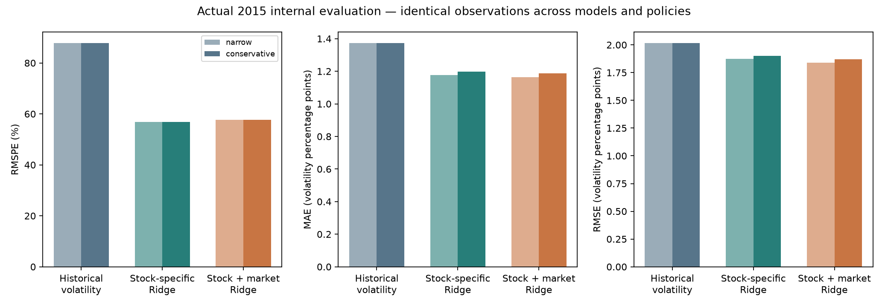

# Project 002 · Daily Stock Volatility Prediction and Model Failure Analysis

**Human-led quantitative research · AI-assisted implementation.** Three trained
models, chronological internal evaluation, quality evidence, failure analysis and
an interactive Streamlit dashboard. The advanced stock-vulnerability/reference
hypothesis remains a future extension, not a claim validated by this stage.

Read the [actual results and failures](research/forecast-D008/RESULTS.md) before
drawing conclusions. Only **2013–2015** enters modeling. **2016–2018 remains
reserved for separately approved evaluation.** Project 001 is unchanged; no merge.

## Open the dashboard

Python 3.11 or 3.12, from the repository root:

```bash
cd optiver-realized-volatility
python -m venv .venv
source .venv/bin/activate
# Windows PowerShell: .venv\Scripts\Activate.ps1
python -m pip install -r requirements.txt
python -m streamlit run forecast_app.py
```

The verified results bundle is included. **No Kaggle account, credentials, raw
download or retraining is needed to open it.** Paths resolve relative to the app
file, including when launched from another directory. No synthetic fallback is used.

Explore stock/date/model/policy filters, actual-versus-predicted charts, quarterly
results, RMSPE/absolute-loss disagreement, small-target concentration, failure
return paths, coverage, fit provenance and CSV downloads. Full-study scores stay
visible independently of filters. All compared models use identical observations.

For Streamlit Community Cloud:

| Setting | Value |
| --- | --- |
| Repository | `patelkavitarepo/Data-analytics-portfolio` |
| Branch | `feat/002-optiver-research` |
| Main file | `optiver-realized-volatility/forecast_app.py` |
| Python | 3.11 or 3.12 |

Requirements and results are in the app directory. Once published, open its HTTPS
`streamlit.app` URL in iPad Safari. A cloud machine's localhost is not reachable
from a separate iPad. Hosting is prepared; no public deployment URL is invented
and no account deployment is claimed. Original `app.py` is the preserved Optiver
exploration UI: use **forecast_app.py** for this completed daily project.

## Actual 2015 common-sample results

**111,428 observations / 482 stocks**. RMSPE is a ratio; MAE/RMSE are unannualized
five-session volatility percentage points (1 pp = 0.01 variation).

| Conservative cleaning | RMSPE ↓ | MAE, pp ↓ | RMSE, pp ↓ |
| --- | ---: | ---: | ---: |
| M0 · Historical volatility | 0.8774 | 1.3722 | 2.0146 |
| M1 · Stock-specific Ridge | 0.5688 | 1.1973 | 1.8995 |
| M2 · Stock + market Ridge | 0.5765 | 1.1865 | 1.8714 |

Market inputs improve point-estimate MAE/RMSE versus M1 while worsening RMSPE.
The smallest 1% of actual targets contribute 23.68% of M2's squared percentage
loss but 1.26% of absolute loss. **No small positive target is removed.** Both
Ridge models perform worse than the baseline in the highest realized-volatility
band. Read the full report for both masks, uncertainty and retained failures;
these internal scores are not untouched-holdout or live-performance claims.



## Method and leakage controls

At close t, target `sqrt(sum(r[t+1:t+5]^2))` requires five consecutive valid
exchange-session log returns. No annualization, centering, imputation, invented
prices or new outlier deletion. D003's approved masks are used separately.

M0 projects 20-session mean squared return over five sessions. M1 fits per-stock
log-positive-volatility Ridge on seven own features; M2 adds four broad-market
features with focal exclusion and common conservative donors. The same complete
training rows isolate feature addition. Scaling uses training data only.
Forecasts are exponentiated without clipping or post-hoc calibration.

2014 Q3/Q4 expanding folds choose one alpha per family from the fixed four-value
grid; both choose 100. Tuning labels finish before 2015. Quarterly 2015 refits
use only then-matured labels. **Every training target ends before validation.**
Targets are rebuilt from date/column-filtered discovery returns; existing future-
target columns are not read. Last five origin sessions are not scored. No
2016–2018 model data or scores are loaded.

RMSPE is accompanied by MAE/RMSE, bias, stock-balanced summaries, calendar-block
uncertainty and all non-overlapping-origin offsets. Zero targets would remain
in absolute metrics and be disclosed separately for undefined percentage errors;
none occurs in the actual headline sample. Log-fit limitations are not hidden
behind an epsilon. Retrospective masks, unresolved actions and prior exploration
of 2015 still prevent certified real-time/pristine-holdout claims.

[Approved plan](research/forecast-D008/PLAN.md) · [Pre-score design](research/forecast-D008/design.json)
· [Run provenance](research/forecast-D008/results/manifest.json)
· [Independent verification](research/forecast-D008/verification.json)

## Reproduce training and analysis

The dashboard works immediately. Full reproduction requires the approved immutable
Plotly CSV and D003's verified masks. Keep inputs/private runs in ignored data/
and artifacts/ directories, using fresh output folders.

```bash
python -m pip install -r requirements-quality.txt
mkdir -p data
curl -L https://raw.githubusercontent.com/plotly/datasets/master/all_stocks_5yr.csv \
  -o data/all_stocks_5yr.csv
python -m daily_study.clean \
  --csv data/all_stocks_5yr.csv \
  --evidence research/daily-quality/evidence.json \
  --output artifacts/clean-local-D003
python -m daily_study.forecast \
  --clean-run artifacts/clean-local-D003 \
  --design research/forecast-D008/design.json \
  --output artifacts/forecast-local
python -m daily_study.verify_forecast \
  --run artifacts/forecast-local \
  --output /tmp/forecast-verification.json
python -m daily_study.forecast_bundle \
  --run artifacts/forecast-local \
  --output artifacts/forecast-review-bundle
```

Source SHA256 must be
`6aea253cd19de60b568143991aaf1fa482456565c389205658d236e595e716cf`;
D003 refuses a different snapshot. Original whole-source QC is preserved; the
forecast loader then projects only required 2013–2015 fields. No reserved-period
forecasting result is generated. Source/input hashes are checked before/after.
Fit coefficients, scaling, training cutoffs, tuning scores, predictions,
eligibility flags, label reason bits and failure reconstructions are saved.

Review a reproduced bundle with:

```bash
FORECAST_RESULTS_DIR=artifacts/forecast-review-bundle python -m streamlit run forecast_app.py
```

Exact run versions are recorded. Numerical reproducibility is distinguished from
image/Parquet metadata bytes. The hosted dashboard never trains at runtime.

## Checks

```bash
python -m pytest -q
```

Actual local suite: **64 passed**, Python 3.12.14, with 11 existing calendar
timedelta deprecation warnings. Independent checks replayed 460,486 forecasts
exactly and reconstructed labels/baselines and headline scores. Synthetic test
fixtures are not portfolio findings.

For a real-browser check, start Streamlit separately, then:

```bash
python -m pip install -r requirements-browser.txt
python -m playwright install chromium
APP_URL=http://127.0.0.1:8501 python tests/browser_smoke_forecast.py
```

Set CHROMIUM_EXECUTABLE to use an installed browser and SCREENSHOT_DIR for exports.
Chromium desktop/touch checks were actually run with controls, downloads and no
application/JavaScript errors. Physical iPad/Safari has not been tested. CI checks
Python 3.11/3.12; its current result is separate from local checks.

## Preserved research and authorship

- [Human decisions](research/DECISIONS.md) retain hypotheses, interpretations,
  approvals and D008/D009 scope/training authorization.
- [AI implementation log](research/IMPLEMENTATION.md) separates implementation,
  recommendations, actual checks and limitations from human contributions.
- D001–D006 is frozen at `db4d868a46e7436afcfb41668fcf229a7860d978`, tag
  `research-d001-d006-freeze`; findings, code, masks and evidence remain intact.
- [D003 ledger](research/cleaning-D003/README.md),
  [D004 evidence](research/declines-D004/README.md),
  [D005 CVR proposal](research/CVR-D005/README.md) and
  [D006 feasibility](research/feasibility-D006/README.md) remain accessible.
- [D007 source search](research/source-search-D007/PAUSED.md) stays paused; no
  new source adopted. [Original Optiver foundation](README_OPTIVER_FOUNDATION.md)
  and optiver/ plus app.py are retained, not claimed as official-data results.

The advanced vulnerability/conditional-reference hypothesis is future work. No
reliability score or forced references are added. The lead interprets findings;
AI code is not represented as manually written by the lead. No merge or later-
period evaluation occurs without approval.
