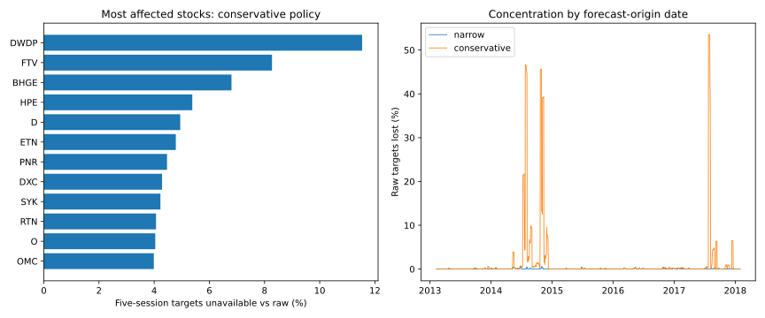

# D003 cleaning: provisional masks, evidence and selection-bias comparison

**Completed implementation, not predictive modeling.** The lead approved masking
and an evidence ledger in D003. Raw prices are unchanged; no record was deleted or
replaced; no model, peer graph, stress threshold or forecasting split was fitted.
The original hypothesis remains that stocks have individual vulnerabilities and
conditional relationships may contain useful warning information. This cleaning
exercise neither supports nor rejects that hypothesis.

## What “cleaned” means here

A frozen raw CSV plus separate analysis views, availability flags and evidence.
All 619,040 original observations are retained exactly in a private aligned-source
artifact. There are 635,795 stock/session positions in the aligned grid: empty
pre-history positions and the 51 interior missing sessions remain absent, never
invented observations. No whole stock or date is dropped. The original CSV's
SHA-256 was checked before and after:

`6aea253cd19de60b568143991aaf1fa482456565c389205658d236e595e716cf`

“Available target” below means mathematically computable under that policy, not
certified free of all vendor errors or corporate actions.

## Comparison definitions

Both views keep missing sessions explicit, disable range features for incomplete
OHLC inputs, preserve zero recorded volume as a flag, and apply **no magnitude
cutoff**. Incomplete open/high/low alone does not mask an otherwise eligible close.

- **Narrow:** provisionally quarantine the 12 internally contradictory price records.
  These are confirmed *record inconsistencies*, not proof of which price field is
  wrong. No replacement value is known. The 2,133 repeated-price records remain
  eligible unless another independent rule applies. Narrow therefore retains
  suspected artifacts and is not a certified reference truth.
- **Conservative:** the narrow masks plus provisional price/volume quarantine for
  both dated copies of every repeated OHLC record. Repetition is **suspicious**, not
  a demonstrated error in a particular dated copy. Neither date is chosen as true.
- **Common economic-action guard:** both views make the 17 verified action-boundary
  returns unavailable, without deleting either price endpoint. Corporate actions
  are real events, not data errors; the guard avoids treating a price break on an
  unverified adjustment basis as an ordinary economic loss. Sharing this guard
  makes the narrow/conservative comparison about repeated-record suspicion.
- An additional **error-only reference** shows the effect of 12 contradictory
  records without action guards, so real corporate actions are never mislabeled
  as strongly supported errors. It is not recommended as economic ground truth.

These operational comparison definitions are AI implementation choices disclosed
for review, not extra decisions falsely attributed to the lead. KLAC's provisional
ex-date and other unresolved moves remain review entries without a new mask.

## Data availability

| View | Price observations masked | Explicit action boundaries | Newly unavailable returns | Available five-session targets | Targets unavailable vs raw |
| --- | ---: | ---: | ---: | ---: | ---: |
| Raw calendar-aligned reference | 0 | 0 | 0 | 616,430 | 0 |
| Error-only reference | 12 | 0 | 24 | 616,358 | 72 (0.0117%) |
| Narrow plus common action guard | 12 | 17 | 41 | **616,277** | **153 (0.0248%)** |
| Conservative plus same guard | 2,145 | 17 | 3,835 | **606,831** | **9,599 (1.5572%)** |

Conservative masking makes **9,446 more targets unavailable than narrow**. No
partial-horizon targets are substituted. Price masks also invalidate both touching
returns. The five-session target is unchanged:

`sqrt(sum(log(C[t+k]/C[t+k-1])**2 for k=1..5))`.

It uses six consecutive exchange-session closes after an after-close origin,
excludes today's return and is not annualized. This remains a daily-sampled
volatility proxy, not intraday realized volatility. A hypothetical 20-return
history requirement plus target leaves 605,287 narrow versus 575,860 conservative
origins (606,000 raw). That lookback is a coverage sensitivity, not a selected
predictive feature.

## Are exclusions disproportionate? Yes

### Stocks

Conservative target losses affect 385 of the 505 tickers. Median per-stock loss is
1.67%, the 90th percentile 3.11%, and the maximum 11.54%. Some short histories are
more exposed in percentage terms:

| Stock | Raw computable targets | Lost under conservative | Loss rate |
| --- | ---: | ---: | ---: |
| DWDP | 104 | 12 | 11.54% |
| FTV | 399 | 33 | 8.27% |
| BHGE | 147 | 10 | 6.80% |
| HPE | 576 | 31 | 5.38% |
| D | 1,254 | 62 | 4.94% |

This is not evidence that these stocks are financially more fragile. Shorter
histories amplify a few exclusions, and shared recording issues drive others.
Do not screen stocks for convenient coverage or good future model scores.
[Full stock comparison](by_stock.jsonl) includes narrow and conservative rates.

### Dates

**The 20 most affected forecast-origin dates account for 49.82% of conservative
label loss.** On each origin from July 25 through August 2, 2017, 269 of 503 raw
labels become unavailable (53.48%). These are origins whose future five-session
windows touch suspect records, not necessarily the dates of the suspect records.

| Origin year | Conservative target loss rate |
| --- | ---: |
| 2013 | 0.0387% |
| 2014 | **5.2126%** |
| 2015 | 0.0267% |
| 2016 | 0.0590% |
| 2017 | **2.4367%** |
| 2018 (partial sample) | 0% |

Missingness is strongly tied to historical calendar periods. Later forecasting
folds can therefore have very different quality/sample composition from earlier
folds. A global 1.56% loss conceals this concentration. It does not establish which
underlying provider event caused the repeated records. [Date comparison](by_date.jsonl).



### Observed market conditions

For this **selection audit only**, not a forecasting regime definition, we used
fixed bands of origin-date cross-stock median log return and median absolute log
return. The following uses price/return-eligible donors under the conservative
policy to reduce obvious artifact contamination:

| Origin-date proxy | Conservative target loss rate |
| --- | ---: |
| Cross-stock median return below −1% | 0.84% |
| Cross-stock median return above +1% | 1.43% |
| Median return within ±1% | 1.64% |
| Median absolute return ≤0.5% | 1.29% |
| Median absolute return 0.5–1% | 1.83% |
| Median absolute return 1–2% | 0.99% |
| Median absolute return above 2% | **0.11%** |

Thus these masks do **not** disproportionately remove the highest broad-market
variation band by this particular measure. That is not a guarantee that all
important stock-specific stress survives, or that this proxy identifies economic
stress correctly. The >2% band contains just 34 origin dates; this is a descriptive
comparison, not a significance test. Ratios use the same raw-computable-label
denominator within each band. No future target value defines a context.

Both raw-donor and quality-eligible-donor proxy versions are supplied in
[by_condition.json](by_condition.json); conclusions can depend on how corrupted
inputs affect context measurement. For example, the raw proxy gives loss rates
0.62%, 1.11% and 1.68% for the three direction bands, versus 0.84%, 1.43% and 1.64%
with eligible donors. Donor counts are reported date by date, not assumed constant.

### Trading activity and unknown context

We also checked current recorded share volume versus that stock's median volume
in the **preceding 20 sessions**, excluding the current session from the reference.
The 2× cutoff is a fixed descriptive audit band, not an optimized research choice.

- Raw-volume proxy: conservative loss is 1.78% in >2× activity versus 1.57% at ≤2×.
- Quality-eligible-volume proxy: corresponding rates are 1.11% versus 0.79%.
- **Unknown activity context grows from 10,430 to 35,354 raw-target origins** when
  suspicious volume records are unavailable and a complete preceding reference is
  required. Of that latter unknown-context group, 13.81% lose their targets.

This illustrates a second selection mechanism: masking can make historical
activity indicators unavailable even where today's price exists. Never relabel
unknown activity as calm or use an arbitrary imputed volume to hide the problem.
The unknown group reflects measurement eligibility, not a proven market condition.
[Both activity versions](by_activity.json) are provided. No order-book liquidity,
spread, or depth claim can be inferred from this daily dataset.

## Genuine shocks and unresolved cases

The AMD April 22, 2016 and VRTX April 19, 2013 returns remain unchanged under both
policies, as do **all five preceding target origins containing each event**: 10
supported shock-containing labels survive in each view. Magnitude alone never
causes a mask. Other genuine shocks may remain among unresolved cases; the two
verified examples are checks, not an exhaustive catalog of real market events.

Conservative still retains 359 targets touching >20% moves outside the verified
corporate-action/known-shock groups; narrow retains 387. This is deliberate honesty:
unresolved does not mean wrong, and retained does not mean verified. The 72 general
unresolved extremes and the provisional KLAC ex-date from the previous investigation
remain open; repeated-record/price-inconsistency tags apply independently where
supported. No causal vulnerability conclusion follows from these counts.

## Complete provenance and exclusion explanations

- [manifest.json](manifest.json): source/evidence/code hashes, exact policy counts,
  calendar/software versions and reason codes. Zero replacements; no trained models.
- [ledger.jsonl](ledger.jsonl): **2,315 cause/review entries**, with stock/date,
  evidence class, rule, policy membership, affected analysis, source links where
  applicable, and timing caveats. Review-only entries explicitly cause no mask.
- [narrow_target_exclusions.jsonl](narrow_target_exclusions.jsonl) and
  [conservative_target_exclusions.jsonl](conservative_target_exclusions.jsonl):
  **every one of the 153 / 9,599 policy-unavailable labels**, with origin, target end
  and the exact cause IDs. Only actual price or future-boundary causes are linked;
  missing opening price alone and an action at the forecast origin do not invalidate
  the next five returns.
- Private Parquet views preserve analysis values and bit-coded price, return and
  target unavailability. An aligned-source artifact retains every recorded original
  field. Empty positions outside a stock's active span are explicit, not deleted
  original observations; they are identified by reason codes 1+32 and coverage.
- Each run ends with an artifact-hash registry. `verify_run` rejects incomplete or
  tampered runs and can recheck the unchanged input file.

The classes are deliberately different: a contradicted record is established as
internally inconsistent while the wrong field stays unresolved; repetition is
suspicion; corporate actions are genuine but adjustment-ambiguous; documented
market shocks are retained; unverified extremes remain review-only. No entry
invents a replacement price or falsely certifies a quote.

## Retrospective versus prediction-time information

**1,066 of the 2,133 repeated records require a later session's observation to
recognize the repetition at that record's date.** Each repeated entry records its
comparison dates and earliest possible detection session if the records had been
delivered. The later copy can be compared to an already observed earlier copy;
the first cannot be flagged this way until the later copy appears.

Even fields inspectable within a single recorded day are not certified available
at that day's close: original vendor delivery/publication timestamps are absent.
Action events are verified retrospectively against company/exchange sources;
that does not prove our pipeline had their notices in real time. Every ledger
entry marks point-in-time delivery as unverified.

The final views are therefore **retrospectively curated research panels**, not a
claim of an implementable historical trading feed. Do not feed `provisional_target_5`,
`target_end`, target eligibility/reason codes, or hindsight quality flags into a
predictor. Missingness from retrospective masks must not be advertised as an
available warning signal. Chronological validation and training-only peer learning
remain necessary, but cannot undo retrospective selection or survivorship bias.

## Reproduce, verify, and interpret

From `optiver-realized-volatility/`, with Python 3.12 and requirements-quality.txt:

```bash
python -m daily_study.clean \
  --csv /private/path/all_stocks_5yr.csv \
  --evidence research/daily-quality/evidence.json \
  --output artifacts/clean-local-D003
python -m pytest -q
python -c "from daily_study.clean import verify_run; verify_run('artifacts/clean-local-D003', '/private/path/all_stocks_5yr.csv')"
```

Use a new output directory. Raw/cleaned analytical observations remain outside
Git; the published ledger, summaries and graphics make the implementation reviewable.
JSON summary formatting may differ between private artifacts and these review
exports; values are unchanged. Artifact hashes verify a specific run, not identical
Matplotlib metadata across future runs with different package versions.

Observed validation: **24 tests passed locally on Python 3.12**, including source
immutability, paired-copy masking, action/target timing, preservation of synthetic
shocks, complete downstream cause links and tamper detection. Tests are explicitly
synthetic and never presented as empirical evidence. Full actual-data checks
separately verified original-field equality in the aligned artifact, no invented
analysis prices, nested policy eligibility, hashes, and the prior conservative
count of 606,831 labels. Warnings are third-party timedelta deprecations, not test
failures. Source data and Project 001 were unchanged.

## Next proposed experiment — for the lead's review, no model training

Start with **descriptive stock-specific response profiles**, using conservative
and narrow views in parallel. A candidate first context is a broad market decline,
measured from observed returns available through each origin. Compare each stock's
own-standardized observed volatility and activity across ordinary versus declining
market conditions, always showing support counts and missingness. Determine an
exploratory/confirmation date allocation before estimating thresholds or comparing
stock relationships; scales and thresholds must come from discovery/training dates
only. The audit bands above are not automatically adopted.

First present distributions/coverage and invite the lead's interpretation; only
then discuss a definition of similar reaction and a prediction experiment. Look
for conclusions that change across masking policies, rather than choosing the
policy that yields the more appealing hypothesis. There is no fitted relationship,
forecast score or claim of shared vulnerabilities yet. A different initial context,
such as unusual trading activity, remains the lead's choice.
