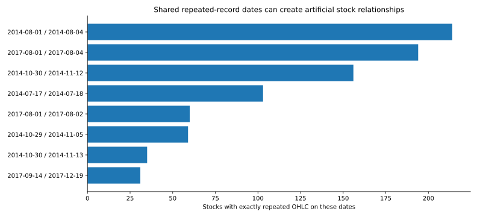
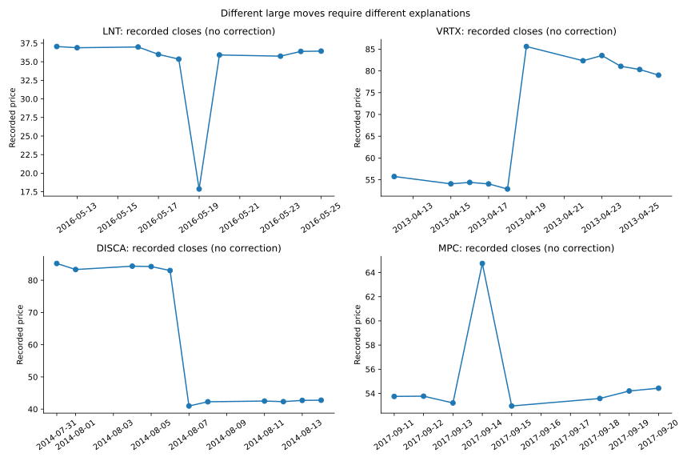
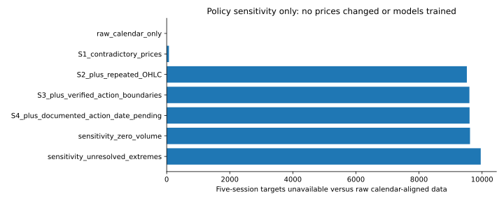

# Data-integrity investigation: daily Plotly pilot

Historical pre-approval investigation. D003 subsequently approved provisional
masking; see the [completed cleaning comparison](../cleaning-D003/README.md) for
current results. The original investigation status and outputs below are preserved.

**Status: investigation complete for the checks described here; cleaning methodology
awaits lead approval. No prediction models trained; zero corrected prices.** This
is not a certification that every price or corporate action is resolved.

The human lead approved Plotly as the pilot source and provisionally approved a
five-session horizon (D002). The original conditional-vulnerability hypothesis
(D001) is unchanged. Analysis, code, source investigation and recommendations below
are AI assistance, not decisions or interpretations supplied by the lead.

## Main conclusion

The file is accessible and broadly complete, but it is **not research-ready merely
because closing prices are populated**. In addition to a few field-level defects,
there is evidence of repeated historical records shared across stocks and dates.
Unadjusted distributions can also masquerade as crashes. Both problems can distort
the exact cross-stock relationships this project aims to study.

No prices have been changed. This report recommends a reviewable masking-and-ledger
policy rather than interpolation, guessed corrections, or automatic outlier removal.
A comprehensive corporate-action-adjusted replacement history is not available
from these fields alone. More external verification is needed before claiming a
complete action-clean history or robust predictive results.

## Snapshot and reproducibility

- [Source](https://raw.githubusercontent.com/plotly/datasets/0c447c47b757ad74edecab31f0d72f849d2e67c2/all_stocks_5yr.csv),
  pinned to Plotly commit `0c447c47b757ad74edecab31f0d72f849d2e67c2`.
- SHA-256: `6aea253cd19de60b568143991aaf1fa482456565c389205658d236e595e716cf`.
- 619,040 rows, 505 tickers, 2013-02-08 through 2018-02-07.
- Columns: date, open, high, low, close, volume, Name.
- Every one of the 1,259 distinct dates matches an XNYS exchange session using
  `exchange-calendars` 4.13.2. No whole-panel sessions are missing; no non-session
  dates appear. This is a software-calendar check, not exchange-certified quotes.
- There is no adjusted-close, split factor, dividend record, permanent security ID,
  publication timestamp, sector history, or historical index membership.

Run from the project directory with Python 3.12:

```bash
python -m pip install -r requirements-quality.txt
python -m daily_study.quality \
  --csv /path/to/unchanged/all_stocks_5yr.csv \
  --evidence research/daily-quality/evidence.json \
  --output artifacts/quality-new-run
python -m pytest -q
```

The runner checks the raw file hash, refuses to overwrite previous audit output,
records code/evidence hashes and software versions, and never writes cleaned prices
or a training dataset. Set `MPLCONFIGDIR` to a writable temporary directory in a
restricted environment. Summary counts and graphics reproduced from the final
run are included beside this report; raw data remains outside Git. Published JSON registries and SVG whitespace are
formatted for review; the recorded values are unchanged.

## Coverage and missing observations

470 stocks have all 1,259 sessions. Recorded histories range from 44 rows (APTV) to
1,259; 22 tickers have fewer than 1,000 observations. Late starts could reflect IPOs,
spin-offs, symbol changes, or collection coverage; absence is not automatically a
data error and should not be backfilled. All 505 tickers reach the final date, so
survivorship/selection bias cannot be ruled out. A complete-case-stock filter
would preferentially retain older surviving securities; do not apply it silently.

Interior missing sessions, between each ticker's first and last observations:

| Ticker | Missing sessions |
| --- | ---: |
| DHR | 16 |
| O | 16 |
| ES | 10 |
| ICE | 5 |
| BMY | 2 |
| ORCL | 2 |
| Total | 51 |

The exact missing dates and coverage for every ticker are in [coverage.json](coverage.json).
Returns must use consecutive exchange sessions. Compressing each stock's rows
would wrongly bridge gaps and yields **85 extra apparently computable five-session
targets** in this file. These are not legitimate five-consecutive-session targets.

11 rows lack one or more OHLC fields: 11 opens, 8 highs and 8 lows are missing.
No close, volume, ticker or date fields are missing. There are no duplicate
stock/date keys, nonpositive recorded prices, negative volume values, or infinite
numeric entries. Four rows have zero volume; this is a flag, not proof of a bad
close. All four also lack opening/high/low information. Do not infer a trade from
a recorded close alone or substitute a small positive volume for log transforms.

## Internal contradictions and repeated records

12 complete-OHLC rows violate `low <= open,close <= high` (or high/low consistency).
Tickers are AOS, BBY, CHD, CHK, DHR, IP, LNT, O (two rows), SPG, UA and WRK.
There are **23 distinct rows** with either missing or contradictory OHLC fields.
[Row flags](row_flags.json) record exact dates and each issue.

The deeper comparison checks different dates for the same ticker:

- **1,508 rows**, **754 pairs**, across **312 tickers** repeat open, high, low,
  close **and volume** exactly.
- Allowing volume to differ, **2,133 rows in 1,066 groups across 380 tickers**
  repeat all four OHLC prices. None of these repeated rows has a zero daily range.
- 214 stocks repeat OHLC across August 1 and August 4, 2014; 169 of those repeat
  volume too. 194 stocks repeat OHLC across August 1 and August 4, 2017.
- 31 stocks repeat OHLC across September 14 and December 19, 2017. MPC repeats
  volume too. FLR, MRO and NWL have the same OHLC but differing volume across those
  dates. The September records produce large jumps/reversals in several names.

These matches are directly verified in the downloaded bytes. Their cause, and
which dated copy is correct, are unresolved. Repetition alone is not mathematical
proof of a bad quote; the clustering across liquid stocks makes a shared ingestion
or date-assignment defect a serious concern. Keeping the earlier or later copy
arbitrarily would invent knowledge about the true observation.



See [repeated_records.json](repeated_records.json) for every group and
[repeated_date_pairs.json](repeated_date_pairs.json) for shared date combinations.
These extend the initial audit, which checked duplicate stock/date keys only.

## Large moves: evidence categories, not one-size-fits-all exclusions

The audit screens **102 adjacent-session close changes exceeding 20% in absolute
value**. This fixed screen prioritizes investigation; it is not a cleaning rule,
an optimal cutoff, or a claim that smaller moves are clean. A separate simple-ratio
screen flags 30 possible split-like changes (within 1% of candidate ratios with at
least a 15% move); those are candidates, never automatic split diagnoses.

Each of the 102 moves has an entry in [large_moves.json](large_moves.json):

| Current evidence category | Moves |
| --- | ---: |
| Documented corporate-action boundary | 17 |
| Documented genuine market move, supported to reported rounding | 2 |
| Internally contradicted price endpoint | 2 |
| Repeated-OHLC endpoint | 8 |
| Documented special dividend, exact primary-source ex-date still pending | 1 |
| Unresolved extreme move | 72 |

The last 72 are **not** classified as errors. Many may be ordinary earnings/news
shocks; they have not been individually verified against reliable quote histories.
The 8 repeated-endpoint moves also remain unresolved; “repeated” is a quality flag.

### No verified replacement-price corrections

**Zero corrections are proposed as verified replacements.** A demonstrated field
contradiction proves not all supplied fields can be right; it does not identify
which field to replace or its correct adjustment basis. Every future correction
must record the original value, independently verified replacement, source,
adjustment convention, affected dates and human approval.

### Corporate actions really occurred, but adjustment factors are not established

The [evidence ledger](evidence.json) links company releases, exchange notices and
SEC filings for all 17 action-boundary observations, covering Agilent/Keysight,
Arconic/Alcoa, Baxter/Baxalta, Baker Hughes/GE plus special cash distribution,
Conagra/Lamb Weston, Citrix/GoTo, Danaher/Fortive, Discovery Series A and C,
eBay/PayPal, both HPE separations, Ingersoll Rand/Allegion, NiSource/Columbia,
Vornado/JBG SMITH, Xerox/Conduent and Yum/Yum China. This list is not a complete
history of actions affecting all 505 securities.

Examples:

- **NI, July 2, 2015:** close changes 45.45 to 16.99. The
  [SEC-filed company release](https://www.sec.gov/Archives/edgar/data/1629995/000119312515243669/d42242dex991.htm)
  confirms the Columbia Pipeline distribution. The raw percentage change ignores
  the distributed asset and is not an ordinary shareholder loss.
- **DISCA/DISCK, August 7, 2014:** both raw closes roughly halve. The
  [issuer](https://ir.corporate.discovery.com/stock-information/cost-basis-and-debt-information/series-c-dividend/default.aspx)
  and [OCC](https://infomemo.theocc.com/infomemos?date=201408&lastModifiedDate=08%2F06%2F2014+13%3A02%3A15&number=35071)
  document Series C share distributions. A model could mistake this mechanically
  shared event for a discovery of conditional vulnerability between two stocks.
  They are also share classes of one issuer, which needs a separate control.
- **LNT, May 19–20, 2016:** recorded closes are 35.35 → 17.87 → 35.91. The 17.87
  value is below that day's recorded low of 35.085. The
  [company confirms](https://investors.alliantenergy.com/News--Presentations/news/news-details/2016/Alliant-Energy-Announces-Second-Quarter-2016-Results/default.aspx)
  a two-for-one distribution on May 19 and post-split trading May 20. That confirms
  the event but does not justify doubling this close or halving the remaining
  fields. Mixed adjustment bases are plausible; exact replacement is unresolved.
- **KLAC, November 26, 2014:** the
  [issuer verifies a $16.50 special dividend](https://ir.kla.com/news-events/press-releases/detail/148/kla-tencor-declares-special-cash-dividend-announces).
  The exact ex-date has not been verified from a primary source in this session.
  That case is kept separate from the 17 verified boundaries.

Conversely, [Apple's June 9, 2014 7:1 split](https://investor.apple.com/faq/) has CSV
closes 92.2242 → 93.70; [Netflix's July 15, 2015 7:1 split](https://www.sec.gov/Archives/edgar/data/1065280/000106528015000027/a991pressreleaseforstocksp.htm)
has 100.3713 → 98.13. Neither shows a sevenfold discontinuity. This supports the
presence of some historical split adjustments, not universal adjustment consistency.
Mechanically adjusting every documented split again would introduce errors.

### Genuine unusual behavior should survive cleaning

- **AMD, April 22, 2016:** 2.62 → 3.99, +52.29%. AMD's
  [results/licensing announcement](https://ir.amd.com/financial-information/sec-filings/content/0000002488-16-000118/q116991.htm)
  establishes the contemporaneous business news; an independent
  [Dow Jones Market Data report](https://www.itiger.com/news/2573608431)
  identifies the historical +52.29% move. Preserve it. This does not independently
  validate every OHLCV field or prove that one announcement caused the move.
- **VRTX, April 19, 2013:** 52.87 → 85.60, +61.91%. The
  [company's April 18 trial announcement](https://investors.vrtx.com/news-releases/news-release-details/treatment-vx-661-and-ivacaftor-phase-2-study-resulted)
  and a [contemporary closing report](https://247wallst.com/investing/2013/04/19/market-close-big-winners-losers-for-april-19-2013/)
  support the unusual move and closing price to reported rounding. Preserve it.

Sources were inspected through retrieved indexed text where direct pages were
not fully readable. Company/SEC/OCC sources establish action events; market
reports establish the two unusual moves. No source is claimed to validate the
entire vendor price series or an unobserved replacement price.



## Why these issues matter to the original hypothesis

1. One wrong close creates **two wrong adjacent returns**, and can contaminate
   six five-session labels because each close anchors two returns. For LNT, the
   five recorded returns from May 19–25 give unannualized RV about **0.9761**. That
   number illustrates contamination; it is not a corrected estimate or forecast.
2. Distributed assets or cash create price-only jumps that are not economic losses
   of the same magnitude. A model can learn corporate-action artifacts instead of
   a stock's vulnerability. Regular dividends, not fully recorded here, remain a
   limitation even after screening large distributions.
3. Shared copied records can produce false zero returns, catch-up jumps, suppressed
   variation and apparent cross-stock co-movement. More flexible conditional models
   may fit those artifacts especially well. No correlations or peers were selected
   in this investigation.
4. Dropping or winsorizing every large move would suppress exactly the real stress
   reactions we want to understand. Conditioning only on “clean-looking” calm
   observations would also introduce selection bias.
5. A quality flag itself may encode retrospective knowledge, not information available
   at the forecast origin. In particular, detecting a repeated December record can
   identify a suspect September observation only with hindsight. A frozen curated
   snapshot can support a conditional research experiment; it cannot by itself
   establish a point-in-time tradable forecasting system.

## Proposed transparent policy — pending approval

Preserve the original snapshot immutably and publish versioned **exclusion masks**
and an evidence ledger. No interpolation, forward filling, winsorization,
re-dating of records, guessed prices, or inferred split factors.

1. Reindex each stock on exchange sessions. Keep late starts and gaps explicit.
   Never bridge absent sessions when calculating daily returns or five-session labels.
2. Mark OHLC/range features unavailable on the 23 incomplete/contradictory rows.
   Missing open/high/low alone does not invalidate an otherwise unflagged close.
   On the 12 contradictory rows, price-field reliability is unresolved: provisionally
   mask price-dependent analysis until independent verification resolves the fields.
3. Provisionally mask prices on **both dated copies** of the 2,133 repeated-OHLC
   records, without choosing which is genuine. This is a conservative research
   quarantine, not a verified correction or a universal duplicate-cleaning law.
4. Mark the **17 verified corporate-action boundary returns** unavailable until a
   consistent adjustment basis is independently established. Do not delete all
   post-event history or claim the rest is action-clean. Keep KLAC in its separate
   provisional-date ledger and complete that check before model training.
5. Keep documented genuine shocks unchanged. Keep other extremes flagged and
   unresolved; continue evidence review rather than automatically remove them.
   The present ledger is a queue, not a certificate that the remaining 72 are valid.
6. Flag zero volume, preserving the recorded value. Show a sensitivity that masks
   those four prices, rather than assuming zero volume proves an erroneous close.
7. Any label or lookback touching an unavailable required return is unavailable.
   Peer inputs use only quality-eligible data through the forecast origin, with
   missingness/peer-coverage reported. Do not change target duration to obtain five
   observed rows. Do not silently fill absent peers or select stocks for good results.

The number of affected observations and targets is measured below. “Unavailable”
means a proposed mask, **not** a deleted/corrected price or an action already applied.

| Cumulative preview | Masked existing price rows | Explicit blocked return boundaries | Five-session labels unavailable vs raw | Labels still computable |
| --- | ---: | ---: | ---: | ---: |
| Calendar-aligned raw closes | 0 | 0 | 0 | 616,430 |
| S1: contradictory prices | 12 | 0 | 72 | 616,358 |
| S2: plus repeated OHLC | 2,145 | 0 | 9,518 | 606,912 |
| S3: plus verified actions | 2,145 | 17 | 9,599 | 606,831 |
| S4 sensitivity: also provisional KLAC boundary | 2,145 | 18 | 9,604 | 606,826 |
| S4 sensitivity: also zero-volume prices | 2,149 | 18 | 9,618 | 606,812 |
| S4 sensitivity: block all >20% moves except the two supported shocks | 2,145 | 100 | 9,958 | 606,472 |

The last line is **not recommended** as a default: unresolved genuine shocks could
be discarded. It brackets the impact of a harsh screen; it does not adjudicate them.
The 100 boundaries overlap action/record masks; counts are unions, not added losses.

S3 masks 0.347% of existing price observations but affects **1.557% of computable
labels**. A hypothetical 20-return lookback plus five-session label would fall
from 606,000 to 575,860 usable origins (4.974% fewer). The 20-return lookback is an
illustrative sensitivity, not a lead-approved feature choice. Longer memory can
amplify the effect of a small number of bad records. “Computable” never means
all remaining labels have been verified; unresolved actions and genuine/error
ambiguity remain. No eligible-stock filter or train/test dates have been chosen.



## Precise five-session target and validation contract

Provisional origin: **after the close of exchange session t**. If C is a verified,
consistently adjusted close series, define:

`r[i,t] = log(C[i,t] / C[i,t-1])`

`target[i,t] = sqrt(r[i,t+1]^2 + r[i,t+2]^2 + r[i,t+3]^2 + r[i,t+4]^2 + r[i,t+5]^2)`

This is a **daily-sampled close-to-close volatility proxy**, not Optiver-style
intraday realized volatility. It includes overnight moves and misses intraday
round trips that finish near the previous close. A final split-only versus
dividend/total-return adjustment convention remains a methodological decision
for the lead; the CSV does not establish either convention consistently.

The target uses five consecutive exchange returns and **six closes**, including
C[i,t]. It excludes today's return. It is not a five-day sample standard deviation,
is not divided by five, and is not annualized. It matures only after close t+5.
A value of 0.02 would mean 2% in these unannualized log-return units, not a claim
of a 2% price change. In this audit, raw-recorded close inputs are used only to
count computability and illustrate sensitivity; their adjustment basis is not certified.
If any required close/return is missing, contradicted or quarantined, the target
is unavailable, with its reason retained. Missing OHLC fields do not automatically
invalidate a close-only target. Zero targets require an explicit RMSPE handling
policy if encountered; this snapshot produces none before quality masking.

No split dates are selected yet. Proposed rules for later approval:

- Split by **whole calendar dates**, with earlier training origins and later
  validation origins. All stocks at a date stay together. Never randomize stock rows.
- Fit on training observations only when their **target end is strictly earlier
  than the first validation forecast origin**. For a five-session target, purge the
  last five training origins before that date. The strict gap is conservative even
  though an after-close origin could know a label ending exactly that day.
- Feature history ending at the origin may include earlier observed training dates;
  that is legitimate history, not leakage. It may never include future returns.
- Refit scalers, imputers, stock sensitivities, context thresholds, peer selection,
  model tuning and all other learned state inside training/inner chronological folds.
  Peer targets for the current validation date are never available. Cross-stock
  close-t features assume the batch of finalized close-t inputs is available.
- Reserve a final confirmation interval before relationship/model exploration.
  Daily five-session targets overlap across neighboring origins, so errors are
  dependent: assess non-overlapping origins or time-block uncertainty, not an
  independent-row confidence interval. Repeated dates across stocks add dependence.
- This audit reviewed the whole historical file for data integrity. Do not describe
  it as a pristine unseen holdout, and do not use anomaly outcomes to select peers,
  features or successful regimes. Freeze the QC policy before forecasting analysis;
  document retrospective masks and seek independent future data for stronger claims.

The tested helper functions implement return alignment, complete-horizon targets,
lookback sensitivity, and target-end purging. They do not train models or select
fold boundaries. A good chronological split cannot undo survivorship bias,
retrospective vendor corrections, unresolved corporate actions or selection of
only easily cleaned observations.

## Research checkpoint

The lead is asked to review the evidence and approve or revise this masking-and-ledger
methodology before any cleaning policy is adopted or models are trained. The main
recommendation is to resolve data-source reliability before attributing measured
stock relationships to economic vulnerabilities. D001 remains a hypothesis,
not a conclusion supported or refuted by this quality audit.
