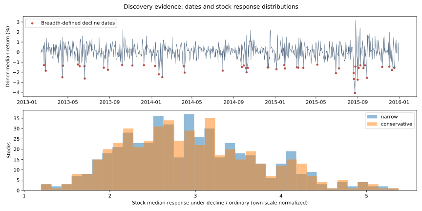
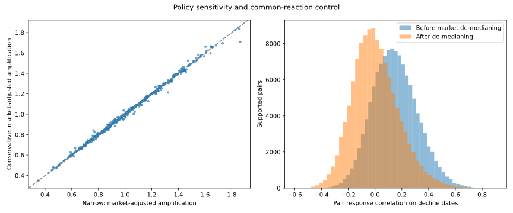
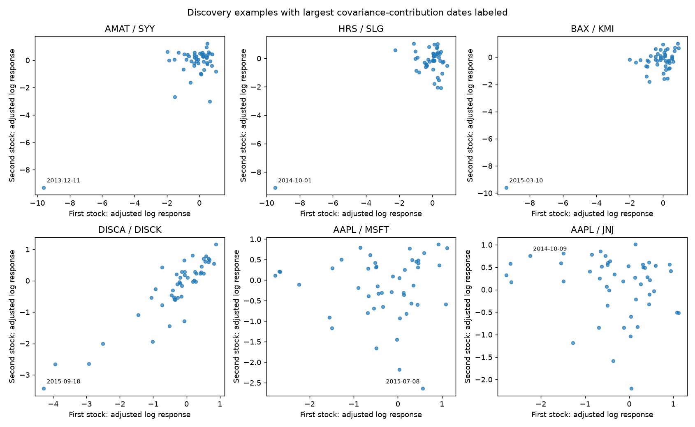

# D004: broad-decline descriptive evidence — lead interpretation checkpoint

**This packet presents observations and methodological checks. The lead's
interpretation is requested before AI conclusions about the hypothesis. No
predictive model, forecast score, causality claim or validated stock relationship
is presented.** Project 001 and the original source are unchanged; no merge.

## Human choice and declared analytical design

The lead chose broad market declines because stocks with different normal behavior
may share vulnerabilities under particular conditions. D001's hypothesis remains
unchanged; D004 records this human choice separately from AI implementation.

The AI supplied the explicit operational definitions in [design.json](design.json).
They were committed in `a0977d8` **before** the primary relationship results were
examined. These parameters are disclosed choices, not additional decisions falsely
attributed to the lead. This is a discovery experiment, not a final definition of
“stress” or a claim that an optimal threshold was found.

- Discovery: February 8, 2013–December 31, 2015, **730 exchange sessions**.
- **2016–2018 relationship results were not examined.** They remain available for
  a later human-directed replication. They are not a pristine untouched dataset:
  earlier integrity work inspected the full source and applied retrospective masks.
- Clean narrow and conservative views come from approved D003. No future target
  columns were read in this experiment; loading requests only date, stock and
  observed log return, with a date filter before relationship computation.
- 505 names exist in the aligned grid; **495 have observed discovery returns**.
  Minimum observation guards leave **489 supported stock profiles** in each policy.
  No absent prices are filled and no whole stock is silently declared valid.

## Precisely what constitutes a decline or ordinary day

At the close of each session, use quality-eligible **conservative-policy donors**
for the context in both response-policy comparisons. Exclude the focal stock from
its context; exclude **both focal stocks** when examining a pair.

1. Require at least **250 eligible donor returns**.
2. A **broad-decline session** has at least **60% of donors with a simple return
   of −1% or worse** that day.
3. The **ordinary comparison** is not every remaining session. It consists of
   non-decline sessions whose donor median simple return is within **±0.5%**.
   Large rallies, other declines and insufficient-donor dates are outside that
   ordinary comparison. “Near-flat comparison days” is the precise description.

Thresholds are constants, not full-sample quantiles or a search for favorable
relationships. Neither rule needs future prices, targets, future normalization
statistics or subsequent news. However, the inherited quality masks themselves
are retrospective, and historical feed-delivery timing is unverified. This is a
formula using through-close observations in a curated snapshot, not a certified
prediction-time trading signal.

The full-donor reference calendar has **50 decline dates**, **397 ordinary dates**,
and **283 other/unavailable dates**. The 50 dates form **28 episode blocks** when
decline dates separated by at most five session positions are grouped. These
blocks are a resampling convention, not proof of independent economic events.
Counts can differ slightly after focal exclusions and measurement warmup; example
pairs below generally have 47–48 usable decline observations in 27–28 matched
blocks. [Context calendar](context_timeline.json).

Predeclared sensitivity definitions give:

| Reference context rule | Decline dates |
| --- | ---: |
| Primary: 60% down at least 1% | 50 |
| 50% down at least 1% | 65 |
| 60% down at least 1.5% | 14 |

The stricter sensitivity is below the primary 20-observation guard for the example
pairs. Its coefficients are displayed with their smaller support; it does not
become a replacement rule or a confirmation test.



## Measuring behavior without forecasting future volatility

Daily **absolute log return** is used as a close-to-close variation proxy. It is
not intraday realized volatility, a fitted conditional variance or the provisional
future five-session target. A close can be unchanged despite substantial intraday
movement, and a large overnight move can dominate this daily proxy.

For each stock/day:

- Own reference scale is the median absolute log return in the **preceding 60
  exchange sessions**, requiring at least **40 observed returns**. The current day
  is excluded from that scale. Zero/missing scales are unavailable.
- Primary reaction is `z = log((abs(current log return) + 0.000001) / own scale)`.
  The tiny constant permits a finite measurement for zero recorded close changes;
  it does not replace a price, impute a missing return or alter the clean dataset.
- For stock profiles, raw amplification is
  `exp(median(z | decline) - median(z | ordinary))`.
  This is a ratio based on median log reactions, not an annualized volatility ratio
  or necessarily a ratio of unnormalized daily medians.
- For a broad common-reaction control, subtract the contemporaneous donor median
  reaction, excluding the focal stock or pair. The same conservative donor-reaction
  series is used for both policies. This is **unit-loading de-medianing**, not a
  fitted model that removes every form of market or sector exposure.
- Market-relative amplification uses the same expression with `z - donor median`.
  Values above one denote a larger typical market-relative reaction in the decline
  subset by this definition. They are not estimated causal vulnerabilities.

Profiles need at least 100 ordinary and 20 decline observations. Pair comparisons
also require at least six matched decline blocks. Unavailable observations and
warmup reduce support; they do not become zero movements.

## Stock-level evidence

Across the 489 adequately supported conservative profiles, raw amplification has
median **2.87** (interquartile range **2.35–3.44**). Market-relative amplification
has median **0.97** (interquartile range **0.79–1.18**). Those describe distributions
of stock statistics; they do not state that a typical stock's standard deviation
was estimated to change by precisely those factors.

Examples below are all conservative-policy observations. HON is shown as the
largest discovery market-relative profile; other examples appear in predeclared
controls or the mechanically selected pair examples. Selection is descriptive and
not corrected for searching many stocks.

| Stock | Ordinary absolute log-return median | Decline absolute log-return median | Own-scale amplification | Market-relative amplification | Ordinary / decline n |
| --- | ---: | ---: | ---: | ---: | ---: |
| HON | 0.334% | 1.807% | 5.38 | 1.85 | 372 / 48 |
| AAPL | 0.723% | 1.737% | 2.53 | 0.81 | 375 / 48 |
| AMAT | 0.656% | 2.376% | 3.21 | 1.06 | 375 / 48 |
| SYY | 0.394% | 1.392% | 3.61 | 1.16 | 373 / 48 |
| KMI | 0.620% | 1.573% | 2.33 | 0.69 | 373 / 48 |

The raw percentage columns and normalized amplification are different summaries:
the reference scale changes through time, so their ratios need not agree.
[All stock profiles](stock_profiles.jsonl) and
[raw variation levels](stock_variation_levels.json) retain counts and both policies.
No ranking here establishes which stock has an economically genuine vulnerability.

## Pair evidence and the shared-market control

Pearson correlation is calculated on the **same adjusted reaction quantity** in
ordinary and decline states. Normal signed-return correlation is recorded separately
so a difference in price direction is not conflated with a difference in variation.
A positive response correlation can reflect jointly small reactions as well as
jointly large ones; it does not specifically mean joint distress.

There are 127,260 possible grid pairs. **119,316 pairs meet the support guards** in
both policies. Among those pairs, the conservative median decline correlation is
**0.140 before** common-reaction de-medianing and **−0.010 after** it. The adjusted
90th percentile is 0.231 and 99th percentile 0.474. This shows the numerical effect
of the specified control; it does not prove that all market influences are removed.



The predeclared screen requires weak ordinary signed correlation (absolute value
≤0.30), weak ordinary adjusted-reaction correlation (≤0.20), decline adjusted
correlation ≥0.40 and an increase ≥0.20, with support in both policies. **1,583 pairs
pass that mechanical discovery screen.** They are not 1,583 established economic
relationships. The complete pair scan is an ignored reproducible Parquet artifact;
[every screen pass](candidate_screen.json) is provided for review.

The three examples selected by the predeclared ranking and three fixed controls
are all retained below. Nothing was substituted after inspecting robustness checks.

| Pair | Selection | Ordinary adjusted Pearson | Decline adjusted Pearson | Decline rank correlation | Decline n |
| --- | --- | ---: | ---: | ---: | ---: |
| AMAT / SYY | Discovery screen | −0.110 | 0.778 | 0.080 | 48 |
| HRS / SLG | Discovery screen | −0.102 | 0.761 | −0.047 | 47 |
| BAX / KMI | Discovery screen | 0.015 | 0.865 | 0.278 | 48 |
| DISCA / DISCK | Fixed same-issuer control | 0.529 | 0.903 | 0.844 | 48 |
| AAPL / MSFT | Fixed control | 0.192 | −0.006 | 0.147 | 48 |
| AAPL / JNJ | Fixed control | −0.026 | −0.180 | −0.219 | 48 |

All table values are conservative. DISCA/DISCK are share classes of one issuer,
verified in the preceding action ledger; this is not an example of unrelated
stocks whose hidden link was discovered. The screen excludes it for strong normal
association. Normal correlation also depends on the comparison subset: AMAT/SYY's
ordinary signed correlation is about −0.010, while its full-discovery signed log
return correlation (including decline days) is **0.277**. The corresponding full
values are 0.295 for HRS/SLG and 0.261 for BAX/KMI. “Weak on near-flat days” is not
identical to “unrelated in all usual market environments.”



### Episode and measurement checks shown alongside the coefficients

| Selected pair | Descriptive episode-bootstrap interval | Range after leaving out one decline block |
| --- | --- | --- |
| AMAT / SYY | −0.214 to 0.938 | 0.053 to 0.835 |
| HRS / SLG | −0.352 to 0.912 | −0.210 to 0.798 |
| BAX / KMI | 0.082 to 0.957 | 0.277 to 0.881 |

The bootstrap resamples whole matched decline blocks 1,000 times with a recorded
seed. These are **post-selection descriptive intervals**, not multiple-testing-
adjusted significance statements. Blocks may still be dependent. No p-value or
“confirmed relationship” label is assigned after a 119,316-pair search.

After the planned rank/episode checks, an additional **post-hoc measurement
diagnostic** was added. It changes no primary selection or result and chooses no
preferred transformation. Every checked variant is reported:

| Pair | Primary log-floor correlation | Log floor 1e−8 | Log floor 1e−4 | Linear absolute-return-ratio correlation |
| --- | ---: | ---: | ---: | ---: |
| AMAT / SYY | 0.778 | 0.885 | 0.498 | 0.130 |
| HRS / SLG | 0.761 | 0.880 | 0.417 | −0.013 |
| BAX / KMI | 0.865 | 0.932 | 0.663 | 0.533 |
| DISCA / DISCK | 0.903 | 0.903 | 0.904 | 0.835 |

For AMAT/SYY, the largest absolute Pearson covariance contribution is the recorded
December 11, 2013 observation. Both recorded close-to-close returns are **zero**.
AMAT closes at 16.83 on both December 10 and 11; SYY at 36.96 on both dates. On
December 11, their recorded high/low ranges are 17.02–16.81 and 37.46–36.68,
respectively. An unchanged close therefore does not imply an absence of intraday
movement. The analogous labeled dates for HRS/SLG and BAX/KMI also have two zero
recorded close changes. These observations are retained; they are **not** declared
data errors on that basis.

[Quote excerpts](recorded_quote_excerpts.json),
[influential observation values](influential_observations.json),
[all transformation checks](floor_and_transform_checks.json),
[full example metrics and sensitivities](examples.json), and
[diagnostic provenance](diagnostic_manifest.json) are supplied so the lead can
interpret those contrasts directly.

## Narrow versus conservative masking and coverage

Both policies use the same quality-eligible context donors and market-reaction
control. Their focal response observations and lagged own scales may differ.
Across supported profiles:

| Available stock/date reactions | Narrow | Conservative |
| --- | ---: | ---: |
| Ordinary comparisons | 182,005 | 180,840 |
| Decline comparisons | 23,301 | 23,248 |
| Profiles passing observation guards | 489 | 489 |

Equal numbers of eligible profiles or pairs do not imply equal samples. Missing
records can remove dates or change a stock's trailing baseline. For supported pairs,
the median absolute policy difference in decline adjusted correlation is 0.0023;
the 95th percentile is 0.0182 and the maximum **0.9419**.

A deliberately selected **post-hoc masking-sensitivity example**, not a new positive
hypothesis candidate, is IBM/SLG:

| Calculation | Decline adjusted correlation | Decline n |
| --- | ---: | ---: |
| Narrow, all its eligible dates | 0.769 | 48 |
| Conservative, all its eligible dates | −0.173 | 47 |
| Narrow restricted to the same 47 dates | −0.172 | 47 |

October 1, 2014 is present only in the narrow paired sample. The matched-date check
is supplied to separate availability effects from other changes in the baseline
scale. It does not establish which original price record was correct.
[Full masking diagnostic](masking_comparison.json).

D003 already documented nonuniform stock/date exclusions. This experiment inherits
those selection effects, changing donor coverage, finite-response warmup and
conditional sample availability. It does not make the cleaning policy point-in-time
valid or automatically resolve remaining corporate actions and price issues.

## Limits of this evidence packet

- This studies **contemporaneous** behavior, not whether one stock provides advance
  warning or improves another's future-volatility forecast. No target values were used.
- Conditioning on a common market decline creates a selected market state.
  Leave-out construction avoids direct self-inclusion, not every conditioning bias.
- The trailing own scale adapts over time; it is not an invariant vulnerability
  parameter and can remain elevated after a turbulent period.
- Unit-loading de-medianing leaves heterogeneous market exposure, sectors, same-issuer
  links, other common shocks, liquidity differences and nonlinear effects unresolved.
- Pearson correlation, rank correlation, low-movement handling and episode influence
  are different measurements. The packet preserves their differences for review,
  rather than declaring a preferred result after seeing them.
- Searching many pairs inflates attractive extremes. The reported screen is discovery,
  not error-rate-controlled testing; later data are not used to select these examples.
- A daily absolute close change misses intraday round trips. Price rounding, recorded
  zeros, vendor artifacts, survivorship and adjustment ambiguity remain limitations.
- Formula inputs stop at each date, but the inherited retrospective quality masks
  may use later-session comparisons. No certified real-time strategy is claimed.
- No AI conclusion supporting or rejecting D001 is provided before lead interpretation.

## Reproduce and verify

Install requirements-quality.txt and reproduce/verify D003 first. Then, from the
project directory:

```bash
python -m daily_study.declines \
  --clean-run artifacts/clean-local-D003 \
  --design research/declines-D004/design.json \
  --output artifacts/declines-local-D004
python -m daily_study.decline_diagnostics \
  --clean-run artifacts/clean-local-D003 \
  --design research/declines-D004/design.json \
  --experiment artifacts/declines-local-D004 \
  --output artifacts/decline-diagnostics-local-D004
python -m pytest -q
```

Use fresh output directories. Primary and diagnostic artifacts include hashes and
explicit provenance. Public profile/observation registries are reformatted for
review; values are unchanged. The full private pair scan can be reproduced from
approved local input without publishing a trained graph or model.

Observed checks: **32 tests passed on Python 3.12**. Tests cover exact leave-out
medians, no current/future contamination of own scales, focal exclusion, fixed
support guards, deterministic episode resampling, date/column-filtered loading,
zero-preserving diagnostics and an end-to-end synthetic descriptive run. Fixtures
are never presented as market evidence. A separate actual-data spot-check uses
independent pandas donor deletion/medians/correlations for 30 policy/pair cases;
the complete primary pair table also reproduced identically across two runs.
A display-only shared-axis issue was corrected before publishing the final charts.
Project 001 and the cleaned/source artifacts are unchanged.

## Lead interpretation requested

How do you interpret these patterns in relation to your hypothesis, considering
the market-control, episode, measurement and masking checks?

The lead's response will be recorded separately before AI conclusions or a next
research decision. No prediction training or later-period replication begins here.
