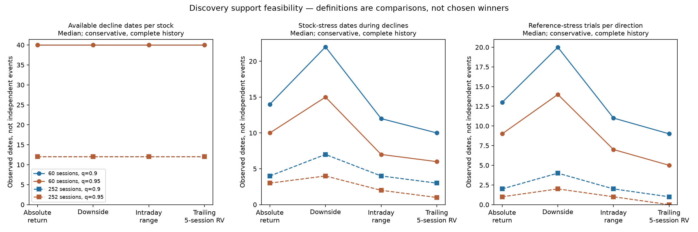
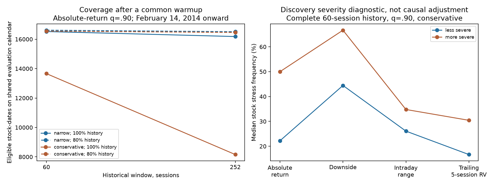
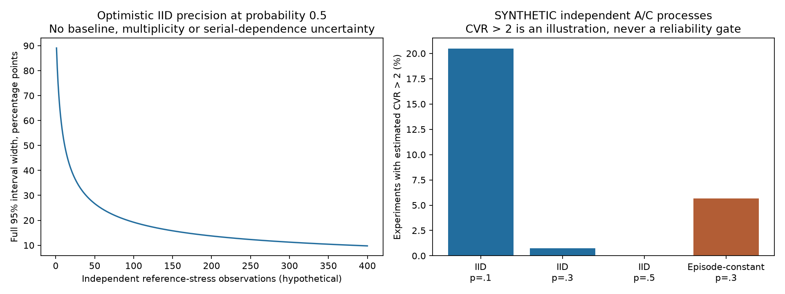

# D006: discovery-only feasibility — evidence and next-methodology review

**The current sample supports descriptive stress comparisons and an honest
assessment of uncertainty. It does not establish that we can reliably identify,
compare or combine stock-specific reference relationships.** No individual pair
is accepted or rejected here. No observed pair CVR, predictive result, candidate
ranking, weighted score or final reliability gate is produced.

This is the AI-assisted analysis requested in the lead's D006 approval. The human
objective remains a context-aware volatility model that compares multiple
references, detects redundant information and can use no reference when evidence
is inadequate. [Human decisions](../DECISIONS.md) and
[AI implementation/verification](../IMPLEMENTATION.md) remain separate.

## Scope and fixed comparison design

[design.json](design.json) was committed at `779af1e` before inspecting feasibility
results. Every combination is reported, without selecting a definition based on
association strength:

- Discovery February 8, 2013–December 31, 2015: 730 sessions, 495 names with at
  least one observed discovery return. No minimum-support stock screen is applied
  to make support look better. Names with no eligible states stay in the audit.
- Four measurements: absolute log return; negative-return magnitude with positive
  returns set to zero; intraday `log(high/low)` with OHLC eligibility; and
  backward-looking five-session `sqrt(sum(r^2))`, requiring all five returns.
- Own-history windows 60/252 sessions, quantiles 0.90/0.95, and complete-history
  versus at-least-80%-observed comparisons: **32 definitions under each policy**.
  Required historical counts are 60/252 or 48/202. These coverage settings are
  audit cases, not adopted final eligibility/reliability rules.
- At t, the threshold uses only t-H through t-1, linear quantile interpolation,
  and strict exceedance. Today is excluded from normal behavior. Current missing
  measurements, unavailable thresholds and degenerate zero quantiles are unknown,
  not nonstress. Zeros and genuine extreme returns are not deleted or clipped.
- The partial-coverage case can start after 48/202 recorded historical observations
  at the dataset boundary; it does not invent earlier observations. A common
  evaluation calendar from February 14, 2014 controls for the longest warmup across
  measurements. Common-calendar and common-eligible-date diagnostics are both supplied.
- D004's decline rule is retained: 60% of at least 250 conservative donors down
  at least 1%; focal exclusion for profiles, exact exclusion of both stocks for
  pair-support counts. Both response policies share the conservative donor context.
  The ordinary condition remains the near-flat comparison, not every non-decline.
- All 122,265 pairs of discovery-observed stocks enter **anonymous support
  distributions**. No D004 screen, pair coefficient, ranking or example selection
  is reused. Four event counts can be inspected for support without estimating
  which pair has the greatest excess co-stress.

The primary market calendar has **50 decline dates**. Grouping decline dates
separated by at most 1, 5 or 10 session positions yields **45, 28 or 21 blocks**.
These are algorithmic groups, not certified independent economic episodes. The
pair-support reference calendar is the union of possible leave-two-out decline
dates; in this source it also contains 50 dates. Blocks are fixed before unknown
stock states are removed, so missingness cannot manufacture new episodes.

## 1. Available support is modest and changes substantially with the definition

Below are **conservative policy, complete historical windows**. Each entry is a
median across the whole eligible audit universe: stocks for the stock column,
pairs for the last two. A median of zero includes absent evidence; it is not
silently removed. Counts do not measure strength or establish independent samples.

| Measurement | History | Quantile | Stock stress dates during declines | Pair joint-stress dates | Pair co-stress blocks, gap 5 |
| --- | ---: | ---: | ---: | ---: | ---: |
| Absolute return | 60 | 90th | 14 | 6 | 5 |
| Absolute return | 60 | 95th | 10 | 3 | 3 |
| Absolute return | 252 | 90th | 4 | 1 | 1 |
| Absolute return | 252 | 95th | 3 | 0 | 0 |
| Downside magnitude | 60 | 90th | 22 | 12 | 9 |
| Downside magnitude | 60 | 95th | 15 | 7 | 5 |
| Downside magnitude | 252 | 90th | 7 | 2 | 2 |
| Downside magnitude | 252 | 95th | 4 | 1 | 1 |
| Intraday range | 60 | 90th | 12 | 5 | 3 |
| Intraday range | 60 | 95th | 7 | 3 | 2 |
| Intraday range | 252 | 90th | 4 | 1 | 1 |
| Intraday range | 252 | 95th | 2 | 0 | 0 |
| Backward five-session RV | 60 | 90th | 10 | 4 | 2 |
| Backward five-session RV | 60 | 95th | 6 | 2 | 1 |
| Backward five-session RV | 252 | 90th | 3 | 0 | 0 |
| Backward five-session RV | 252 | 95th | 1 | 0 | 0 |



For absolute return, 60 sessions/90th percentile, **6.3% of pairs have co-stress
in at most one reference block**. At 252 sessions/95th percentile, that is **89.7%**;
64.6% have no co-stress dates. The 252/95th intraday-range case has 66.4% with no
co-stress, and backward five-session RV has 83.7%. No inference of absence of
population association follows from these zeros.

Downside stress supplies more events because negative moves are common in broad
declines and its own historical threshold is based on downside magnitude, not
the absolute-return distribution. More support does not prove better relationships.
Intraday range misses overnight moves; five-session RV creates overlapping
observations and persistence. These are different economic questions, not
interchangeable attempts to obtain a favorable coefficient.

History choice also changes states **on the same eligible observations**.
For conservative absolute-return/90th-percentile stress, 60 versus 252 sessions
disagree on 710 of 8,157 common eligible stock-dates (8.7%). Among the 3,282 dates
stressed under either definition, 21.6% disagree. At the 95th percentile, 700 of
8,157 disagree, or 32.1% of dates stressed under either definition. That is an
operational-definition sensitivity, not evidence one history is correct.

## 2. Coverage and cleaning can dominate the comparison

Absolute-return/90th-percentile results illustrate all coverage cases, without
choosing one as a final method:

| Policy | Window | Required historical coverage | Eligible decline stock-dates | Median paired joint-stress dates |
| --- | ---: | ---: | ---: | ---: |
| Narrow | 60 | Complete | 22,241 | 7 |
| Conservative | 60 | Complete | 19,360 | 6 |
| Narrow | 60 | 80% | 22,365 | 8 |
| Conservative | 60 | 80% | 22,303 | 8 |
| Narrow | 252 | Complete | 16,182 | 5 |
| Conservative | 252 | Complete | 8,157 | 1 |
| Narrow | 252 | 80% | 18,415 | 6 |
| Conservative | 252 | 80% | 18,363 | 6 |

A single missing return can disqualify many subsequent complete historical
windows. Conservative versus narrow removes 2,881 stock-dates under complete
60-session history, and 8,025 under complete 252-session history. At 80% coverage,
the differences fall to 62 and 52. On the common dates, complete-history absolute
stress states match exactly. With partial histories, they differ on 83/22,303
dates for H60/q90 and 69/18,363 for H252/q90: missing past measurements can alter
today's quantile despite the same current return. These are not corrected prices.

Longer warmup is only part of the loss. Restricting both windows to the common
February 14, 2014 onward evaluation calendar gives 13,661 versus 8,157 available
conservative stock-dates for complete H60 versus H252. Corresponding narrow counts
are 16,522 versus 16,182. Thus incomplete windows amplify the conservative mask's
effect beyond simply waiting longer at the start.

Selection varies by time. Under conservative H60/q90/complete, 2014 has 4,184
eligible stock-dates out of 6,267 finite current-return stock-dates on declines;
2015 has 10,907 out of 11,796. Roughly 33.2% versus 7.5% of finite current
observations are lost to historical eligibility. This compares different years,
not randomized treatment effects. Starting histories, stock entry, missing data
and masking all contribute; the year difference cannot be called purely a cleaning
effect. The complete stock and year registers preserve those differences.

The 80% case retains more evidence but estimates quantiles from unequal numbers
of measurements, possibly missing disproportionately stressful observations.
The complete case uses fixed counts but selects cleaner histories and can omit
much of a stock's stress experience. **Neither is automatically unbiased.**



## 3. Attainable precision and the meaning of an independent observation

The median number of paired **reference-stock stress observations**, counting
both possible directions, is 13 for conservative absolute H60/q90/complete, nine
for q95, two for H252/q90 and one for H252/q95. The denominator for P(A|C,M) is
these C-stress observations, not all 50 market-decline dates and not 495 stocks.

An optimistic independent-Bernoulli Wilson benchmark at probability 0.5 gives
the following **full** illustrative 95% interval widths:

| Independent reference-stress observations | Full width, percentage points |
| ---: | ---: |
| 5 | 65.9 |
| 10 | 52.7 |
| 20 | 40.1 |
| 50 | 26.7 |
| 100 | 19.2 |
| 200 | 13.7 |
| 400 | 9.8 |

At the observed median 13 reference-stress dates, that benchmark spans **47.8
percentage points**. It is not a fitted interval for a pair and ignores baseline
rate uncertainty, serial dependence, threshold estimation and multiple selection.
No pair CVR confidence interval or statistical confirmation is claimed.

For individual stock stress frequency, 1,000 joint whole-block resamples yield
median finite-resample interval widths of about 29.8 percentage points for
conservative H60/q90/complete, versus 27.6 with narrow cleaning. These are
**fixed-historical-state, descriptive marginal intervals**, not conditional-pair
intervals or a calibrated financial confidence guarantee. Undefined-resample
rates and no-event/zero-width cases are disclosed in definitions.json. A bootstrap
cannot reveal unseen co-stress or account automatically for uncertain thresholds.

The gap convention matters. In alphabetical per-stock profiles for conservative
H60/q90/complete, median stress-supporting blocks are 12/11/8 with gaps 1/5/10.
The median concentration-equivalent block count is about 10.7/7.8/5.8. This last
quantity is `1/sum(event-share-per-block^2)`: a concentration descriptor, **not an
effective independent sample size**. Shared macro conditions can persist between
blocks. No data-driven assertion of 28 independent episodes is justified.



The right panel above uses **synthetic experiments, not stock-pair results**.
Each scenario has 10,000 simulations on a 50-date calendar:

- Truly independent A/C, each stressed with probability 10%: 60.0% of experiments
  observe no co-stress; 1.02% have undefined CVR; 20.49% nevertheless estimate
  CVR above two. That is not a false-positive rate for a valid test—CVR>2 is only
  an illustration and is not adopted as a decision rule.
- At 30% stress probability, independent daily draws exceed two in 0.76% of
  experiments. If each stock's independently drawn state instead persists for
  its entire episode, using the actual 28-block length pattern, this rises to
  5.68%. Population pooled lift remains one in both scenarios. Repeated dates
  can exaggerate apparent evidence even without dependence between the stocks.
- Independent stocks within mild/severe strata, with stress probabilities
  0.1/0.8, have population pooled lift 1.605 despite within-stratum independence.

Those scenarios demonstrate failure modes, not calibrated probabilities for
this market panel. The source cannot certify actual episode independence.
Adding more pairs or more simulation repetitions does not create market evidence.

## 4. Broad severity remains a credible alternative explanation

For a diagnostic only, divide discovery decline dates at their donor median return
median of **−1.553%**, producing two groups of 25 dates. This split uses the whole
discovery distribution, so it is explicitly **retrospective diagnostic stratification**,
not an as-of stress rule for early discovery dates. A deployable context would
need its own approved fixed or past-only boundaries. Stock stress thresholds
themselves remain past-only, and the original breadth condition remains fixed.

For conservative absolute H60/q90/complete, median individual stock stress
frequency is **22.2% in the less-severe group versus 50.0% in the more-severe
group**. Conditional frequencies need not equal the nominal 10% historical tail.
Different stock-date coverage remains visible in the counts.

The anonymous pair audit also computes a **counterfactual severity-mixture lift**:
assuming independence within each severity group, use its paired marginal stress
rates to calculate expected joint frequency, then compare it with the pooled
marginal-product baseline. It never uses observed joint count n11. Its median is
1.111 for conservative absolute H60/q90/complete and 1.186 at q95. This is not
observed CVR, a causal explanation or an estimated amount to subtract from each
pair's relationship. It shows that the observed marginal severity composition
alone can mechanically imply apparent pooled association. Sparse stratum rates
are noisy, and two groups cannot control all market, sector or issuer exposures.

## 5. What this evidence can and cannot support

| Methodological option | Evidence attainable now | Remaining uncertainty/tradeoff |
| --- | --- | --- |
| Retain all definitions as a descriptive pilot | Stress-frequency, coverage, event concentration and method-sensitivity comparisons | No dependable ordering of reference quality or predictive benefit |
| Use a declared short historical window for a limited future discovery study | More contemporaneous support, interpretable own-history exceedance | Tail thresholds are noisy; dates cluster; formal pair reliability may remain insufficient |
| Use long histories with strict completeness | Fixed baseline counts and longer historical reference | Severe coverage selection, few informative paired events; currently especially weak support |
| Permit incomplete long histories | More usable observations and longer nominal reference | Unknown missingness bias and varying quantile precision; cannot select it merely for larger counts |
| Expand auditable history before final criteria — AI recommendation | More distinct contexts and stress episodes, better own-history warmup | Requires actual data access, adjustment/membership audit and new feasibility counts; no guaranteed success |

No numerical score, positive/negative relationship category or final reliability
threshold is assigned. Some definitions clearly leave insufficient support for
precise conditional probabilities; even the better-supported cases cannot be
called reliable solely from this audit. This neither confirms nor refutes D001.

For the eventual multiple-reference model, pairwise CVR cannot establish that
C2 adds information after C1, the focal stock's own state and the market are
known. Several apparently related references may be one repeated market signal.
A naive joint-state table has up to 2^k configurations for k references, before
adding focal and market states. As a **hypothetical** support illustration, with
50 independent decline dates and independent reference stress probability 0.3,
three references all stressed have expected count 1.35; five have 0.12. Actual
dependence could change these numbers, but cannot be assumed beneficial.

Current simultaneous A/C stress describes a focal state already observed at
today's close. It does not establish a forecast warning. Later research must test
reference information available at t against A's future five-session outcome,
controlling own-stock/market information, overlapping labels, complexity and
reference redundancy. Candidates, measurement and quality information must be
available at that origin. Model comparisons should include an own-plus-market
baseline and the ability to use **no reference**. None is trained here.

## 6. Precisely what additional evidence would help

1. **More pre-2016 discovery history**, covering distinct market stress episodes,
   plus at least 252 preceding sessions for the historical baselines (and five
   returns for the backward-RV measurement). Merely adding warmup before February
   2013 recovers some dates but does not supply additional independent crises.
   Expanding backward over multiple market cycles can preserve 2016–2018 as a
   later relationship test. Acquiring post-2018 discovery data would require a
   newly approved, chronologically later validation design; 2016–2018 could not
   then be presented as forward-time confirmation of that discovery.
2. **Precision-driven event planning**, before final reliability criteria. If the
   lead eventually wanted a worst-case 95% probability interval of ±10 percentage
   points, an IID Wilson calculation needs about 93 independent C-stress trials;
   ±5 points needs about 381. At a hypothetical conditional reference stress rate
   30%, that corresponds to roughly 310 or 1,270 independent eligible decline
   observations. These are planning illustrations, not new gates, elapsed-year
   guarantees or sufficient sample sizes for CVR/conditional effects. Dependence,
   an uncertain baseline, many candidates and multiple references need more.
3. **Aligned and auditable prices** with split/corporate-action records, consistent
   OHLC adjustment, dividend treatment, actual exchange calendars, historical
   stock membership and delistings. More dates for today's survivors alone would
   not remove survivorship/selection bias. Do not mix adjusted close with
   unadjusted high/low without resolving their economic meaning.
4. **Point-in-time quality evidence**: original publication/availability and
   revision times, so we can distinguish decisions possible then from hindsight.
   D003's first repeated-record flags sometimes require later sessions; source
   delivery timestamps and comprehensive adjustment metadata remain unavailable.
   A chronological split does not fix future-informed cleaning inputs.
5. **Varied, independently motivated contexts and counterexamples**, including
   C-stress/A-nonstress and different severity levels. Additional contexts should
   answer new human-chosen questions, not relax the decline definition to boost
   observations. Intraday/order-book data would be needed for original liquidity
   mechanisms; more daily close data alone cannot identify them.

These data requirements are not a claim that any new source has been downloaded
or that a specific history will achieve sufficient power. Data access, quality
and stress support must be verified before relying on an expansion.

## Evidence files and verification

- [summary.csv](summary.csv): every one of the 64 definition-policy cases, no winner.
- [definitions.json](definitions.json): complete aggregate count, episode,
  precision and counterfactual-severity distributions, with undefined counts.
- [coverage.json](coverage.json): year/context/measurement availability and ties.
- [mask_comparison.json](mask_comparison.json) and
  [history_comparison.json](history_comparison.json): paired-date diagnostics.
- [Alphabetically ordered stock support CSV, compressed](stock_support.csv.gz):
  all 31,680 stock/definition/policy profiles, including absent support, not ranks.
- [context.json](context.json), [synthetic_precision.json](synthetic_precision.json),
  [IID benchmarks](iid_precision_benchmarks.json), [manifest.json](manifest.json),
  and [independent checks](independent_checks.json).
  [verify_discovery.py](verify_discovery.py) reproduces the independent manual
  history/NumPy and direct-donor-deletion checks; [review_checks.json](review_checks.json)
  records the public export/implementation verification.

Actual verification: **42 tests passed** on Python 3.12.14, with 11 existing
third-party timedelta deprecation warnings. New tests cover current/future
exclusion, unknown versus nonstress, quantile coverage/degeneracy, backward-only
RV/gaps, exact pair exclusion/medians, market-defined episodes, sparse-bootstrap
failure, synthetic reproducibility, protected-column/date filtering, immutable
input hashes and an end-to-end no-model run. Independent NumPy historical-window
calculations matched pandas state outputs for 23,360 actual discovery stock-date/
definition cases; six direct donor-deletion paired-count checks agreed. The
first spot-check invocation used the wrong working directory and stopped before
reading input; the corrected invocation completed. All six numerical registries
match exactly between the initial and finalized run; the final revision adds
input-integrity checks, software provenance and PNG/chart exports, not changed
definitions or results. All three final charts were visually inspected.

The original CSV hash remains
`6aea253cd19de60b568143991aaf1fa482456565c389205658d236e595e716cf`.
All four input hashes match the D003 registry before and after the final run.
Only date-filtered discovery columns were parsed: no target columns or 2016–2018
relationship observations. Whole-file byte hashing verifies integrity, without
calculating later-period relationships. Public numerical exports match the run.
Private raw data/cleaning artifacts are unchanged. Project 001 is unchanged.

To reproduce from the project directory after reproducing D003:

```bash
python -m daily_study.feasibility \
  --clean-run artifacts/clean-local-D003 \
  --design research/feasibility-D006/design.json \
  --output artifacts/feasibility-local-D006
python -m pytest -q
PYTHONPATH=. python research/feasibility-D006/verify_discovery.py \
  artifacts/clean-local-D003 > /tmp/feasibility-independent-checks.json
```

Use a fresh output directory. Source/cleaning hash verification is mandatory.
Numerical registry reproducibility is distinct from SVG/PNG metadata bytes.
The earlier [D005 methods and statistical sources](../CVR-D005/README.md) remain
the methodological reference; this feasibility run does not certify inferential
assumptions or bypass the lead's final-methodology approval.

**Review requested:** approve a next methodological direction before final
reference criteria. The recommendation is to keep this as a descriptive pilot
and seek a longer, auditable pre-2016 discovery history, preserving the reserved
later period. No additional data source, final threshold or prediction model is
adopted by this report. Nothing has been merged.
