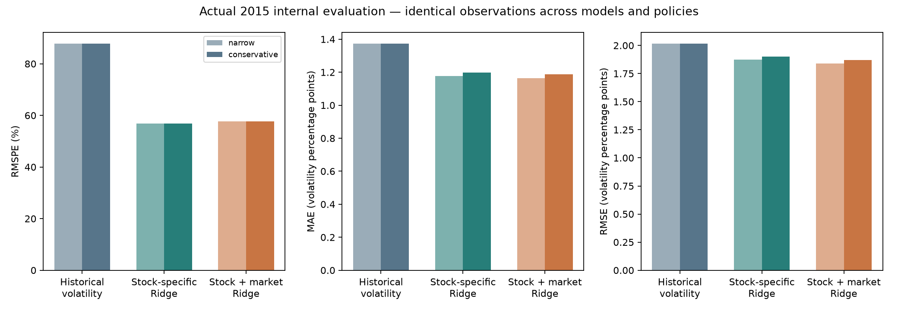
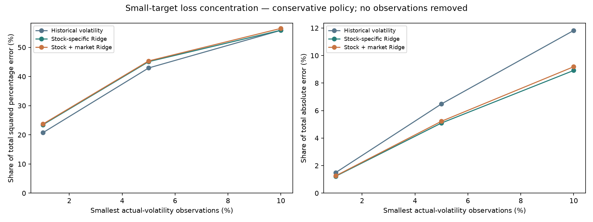
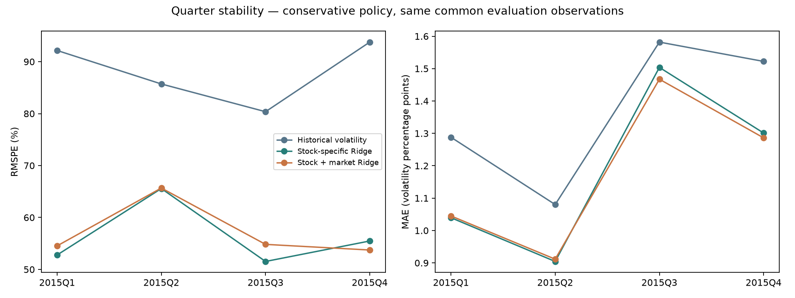

# Actual forecasts and model failures — lead review

The approved D008/D009 experiment is implemented and trained. These are actual
2015 quarterly out-of-sample forecasts within the previously explored discovery
period: **internal evaluation**, not pristine holdout evidence, live trading,
causality or a test of the advanced reference-stock hypothesis.

The lead supplied the hypothesis, scope, approval and metric-disagreement
requirement. Code and analytical implementation are AI assistance.
[Decisions](../DECISIONS.md), [approved plan](PLAN.md) and
[design fixed before scores](design.json) preserve that distinction.

## Headline results

All six rows use exactly **111,428 common stock-date observations across 482
stocks**, origins January 2–December 23, 2015, targets ending by December 31.
No positive target is trimmed, and no denominator epsilon is added. There are
**zero zero-valued targets** in this sample; every headline row enters RMSPE.

RMSPE is a ratio (multiply by 100 for the dashboard's percent display).
MAE/RMSE are unannualized five-session volatility percentage points: 1 pp = 0.01
variation. They are neither annualized volatility nor dollar-return errors.

| Cleaning | Model | RMSPE ↓ | MAE, pp ↓ | RMSE, pp ↓ |
| --- | --- | ---: | ---: | ---: |
| Narrow | Historical volatility M0 | 0.8774 | 1.3722 | 2.0146 |
| Narrow | Stock-specific Ridge M1 | 0.5677 | 1.1763 | 1.8723 |
| Narrow | Stock + market Ridge M2 | 0.5768 | 1.1648 | 1.8394 |
| Conservative | Historical volatility M0 | 0.8774 | 1.3722 | 2.0146 |
| Conservative | Stock-specific Ridge M1 | 0.5688 | 1.1973 | 1.8995 |
| Conservative | Stock + market Ridge M2 | 0.5765 | 1.1865 | 1.8714 |



Conservative M1's RMSPE is 35.2% lower than M0's; M2's is 34.3% lower. Adding
market inputs to M1 raises RMSPE about **1.36%**, while reducing MAE about **0.90%**
and RMSE about **1.48%**. These are point comparisons, not a declaration that the
market extension reliably helps or harms.

Both Ridge families selected **alpha=100**, the strongest of four declared values,
using completed 2014 tuning outcomes. The same alpha is shared across stocks and
policies within a family. This is the best **tested** value, not a global optimum.
No grid, feature or architecture was expanded after seeing 2015. Log-positive-
target predictions are exponentiated without clipping, smearing or calibration;
they are not asserted unbiased conditional means in original units.

## Why RMSPE and absolute errors disagree

For the same positive actual, dividing both models' errors by it cannot reverse
their individual ordering. Aggregate rankings can change because:

```text
MAE    = mean(abs(error))
RMSE²  = mean(error²)
RMSPE² = mean(error² / actual_volatility²)
```

The same miss contributes 100 times more squared percentage loss when actual
volatility is ten times smaller. Comparing RMSE/RMSPE isolates normalization;
comparing MAE/RMSE also changes the loss power.

| Conservative loss concentration | Model | Squared percentage loss share | Absolute loss share |
| --- | --- | ---: | ---: |
| Smallest 1%: 1,115 rows | M0 | 20.72% | 1.49% |
| Smallest 1% | M1 | 23.45% | 1.23% |
| Smallest 1% | M2 | 23.68% | 1.26% |
| Smallest 10%: 11,143 rows | M0 | 55.85% | 11.82% |
| Smallest 10% | M1 | 55.87% | 8.92% |
| Smallest 10% | M2 | 56.50% | 9.19% |



Every observation stays in its original headline score. These are contributions,
**not replacement scores after deleting quiet cases**.

Outcome bands were fixed from 2014 tuning targets. Their q10/q50/q90 boundaries
are 1.1323% / 2.3635% / 4.8873% five-session variation. Grouping by realized 2015
outcomes is retrospective explanation, never a model input.

In each of the three bands below the 2014 median, M2 has higher squared percentage
loss than M1: weighted contributions sum to about **+0.01337** mean squared
percentage error over the complete sample. All three higher bands improve,
contributing about **−0.00448**. Their balance accounts for the worse aggregate
RMSPE. Additive contributions refer to RMSPE's squared value, not its square root.

The highest-volatility band shows an important failure, despite overall gains:

| Actual target above 2014 q90: 15,311 rows | RMSPE | MAE, pp | RMSE, pp |
| --- | ---: | ---: | ---: |
| M0 | 0.4447 | 2.8785 | 3.7986 |
| M1 | 0.5310 | 3.6287 | 4.3999 |
| M2 | 0.5167 | 3.5089 | 4.3142 |

Both Ridge models are worse than the baseline in this band. No metric is switched
to select a preferred story or infer protection against extreme outcomes.

## Actual retained failure cases

The full ledger retains the declared top five absolute and five relative errors
for every model/policy. Examples below use conservative cleaning.

| Case | Forecast | Actual | Failure |
| --- | ---: | ---: | --- |
| PWR, October 9, M2 | 2.7254% | 33.6944% | Underprediction by 30.9690 volatility pp |
| KMI, December 4, M1 | 40.6488% | 8.6855% | Overprediction by 31.9632 pp; baseline 10.2172% |
| MDLZ, June 19, M2 | 1.8860% | 0.1388% | Miss 1.7472 pp; percentage error about 1,259% |
| KLAC, November 4, M0 | 8.8886% | 0.4764% | Miss 8.4122 pp; percentage error about 1,766% |

**PWR:** the target includes October 16's recorded close change from 26.21 to
18.74, about −28.5% simple return. Quanta released preliminary quarterly results
that day, **after** the forecast. This is verified context, not proof of a precise
causal price effect; the event was not a feature. Several high-error origin
windows contain this same shock, not independent surprises.
[Company announcement](https://investors.quantaservices.com/news-events/press-releases/detail/194/quanta-services-announces-preliminary-third-quarter-results).

**KMI:** post-hoc replay of the actual M1 fit shows all seven own inputs beyond
their observed ranges in its 534-row training sample. Backward five-session
variation was 18.06%, versus a training maximum of 7.46%. Saved standardized
contributions exactly reproduce the 40.65% forecast. This demonstrates fitted
function extrapolation, not an economic cause. A lower dividend plan announced
December 8 falls inside the target window, after this forecast, and is only
retrospective context.
[Contribution/range evidence](kmi_extrapolation.json) ·
[Company announcement](https://ir.kindermorgan.com/news/news-details/2015/Kinder-Morgan-Announces-2016-Outlook/default.aspx).

**MDLZ:** the five subsequent recorded closes were 41.050, 41.095, 41.080, 41.080,
41.110, after the origin close 41.040. They yield a small target in this recorded
close-to-close measure. High/low ranges and volumes vary; these are not five
identical OHLC records. Small close variation does not establish low intraday
risk. No price is corrected or event cause invented. A modest volatility-point
miss becomes huge when divided by that small target.

**KLAC:** the 20-session baseline retains earlier variation, followed by a quiet
target window. A proposed combination with Lam was announced October 21, within
that lookback and before the forecast. The announcement is documented context,
not a causal estimate or independent certification of every vendor quote.
[Company announcement](https://ir.kla.com/news-events/press-releases/detail/130/lam-research-to-combine-with-kla-tencor-creating-a-new).

[Quote excerpts](case_quote_excerpts.json), [all failures](results/failure_cases.json)
and [their five-return reconstructions](results/failure_paths.json) retain the
evidence. Verified announcements are distinguished from unresolved attribution.
Cleaning is not revised after these errors.

## Quarter stability and uncertainty

| Conservative RMSPE | Q1 | Q2 | Q3 | Q4 |
| --- | ---: | ---: | ---: | ---: |
| M0 | 0.9216 | 0.8571 | 0.8037 | 0.9377 |
| M1 | 0.5278 | 0.6557 | 0.5153 | 0.5547 |
| M2 | 0.5453 | 0.6567 | 0.5482 | 0.5374 |



M1 is worse than M0 on Q3 **RMSE**: 2.2756 versus 2.2409 pp, despite lower RMSPE.
M2 is worse than M1 on Q2 MAE/RMSE. All five non-overlapping-origin offsets are
reported: conservative M2 RMSPE exceeds M1 in four and is slightly lower in one.

For conservative M2 minus M1, descriptive 20-session calendar-block resampling gives:

- RMSPE point difference **+0.00776**; 95% interval **−0.00955 to +0.02996**.
- MAE point difference **−0.000108** volatility units; interval
  **−0.000274 to +0.000043**.

Both span zero; 60-session sensitivity also spans zero. Only 13/5 blocks exist at
lengths 20/60. Stocks are resampled jointly and forecasts fixed; independent
economic episodes, model-selection uncertainty and calibrated significance are
not established. Point differences should be reviewed with these limits.

## Cleaning and coverage

| Full 2015 origin grid, per policy | Narrow | Conservative |
| --- | ---: | ---: |
| Stock-date grid | 127,260 | 127,260 |
| Available five-session target | 121,214 | 121,196 |
| Own-feature incomplete | 4,342 | 11,738 |
| Outside pre-2015 stock cohort | 5,796 | 5,796 |
| Within-policy three-model eligible rows | 118,765 | 111,428 |
| Common headline across policies | 111,428 | 111,428 |

Reasons overlap. Cohort eligibility uses at least 126 complete, matured positive-
target training origins under both masks before 2015, not later survival or
performance. This guard is not a count of independent observations. All 505 aligned
names remain in the coverage grid. The last five sessions account for 2,525
out-of-discovery-horizon rows per policy and are explicitly disclosed.

M0 is identical on common rows. Learned forecasts can differ because historical
training availability differs. Narrow cleaning's extra 7,337 within-policy rows
are shown separately, not used to flatter a score by changing samples. Complete
60-session histories amplify missingness and exclude stretches after masked rows.

Limits remain: retrospective masks and unknown original feed timing; unresolved
actions/quotes; survivorship; close-only variation; short span and overlapping
targets; quiet-target sensitivity; log-response bias/extrapolation; strongest
tested alpha at the grid edge; and previously explored 2015 data. No reference
reliability conclusion or 2016–2018 evaluation is claimed.

## Verification actually performed

- **64 local tests passed**, Python 3.12.14; 11 existing calendar timedelta
  deprecation warnings. Coverage includes purging, projected discovery-only
  loading, tuning maturity, train-only scaling, zero/tiny targets, metric
  disagreement, paired date resampling, synthetic end-to-end fitting, artifact
  tampering/protected dates and a UI prohibited from calling Ridge.fit.
- A final short-lived reader process aborted after completing its reads at
  interpreter shutdown. New snapshot reads use synchronous Parquet I/O; standalone
  checks and a subprocess regression (including dotted ticker names) exit cleanly.
  No forecast or score changed. The final full suite passed in 16.77 seconds.
- Independently replayed **460,486 actual Ridge forecasts**, maximum absolute
  difference **0.0**, with saved coefficients/scalers and no refitting; reconstructed
  **242,410 targets** and **241,741 baseline forecasts**, and checked six headline
  scores to serialized precision. [Verification record](verification.json).
- Audit additions preserve every original prediction column and five
  score/settings/failure registries exactly; no score-driven retuning.
- Real Chromium checks exercised tabs, policy/metric/stock controls, failure
  model/criterion, CSV download and 390-pixel touch layout without application or
  JavaScript errors. A theme contrast conflict and rerender-sensitive test selectors
  were corrected. Physical iPad/Safari is not tested.
- Lossless bundle exports and input hashes are verified. All parsed model/target
  dates stop in 2015. Source, frozen D001–D006 and Project 001 are unchanged.

The [dashboard](../../forecast_app.py) reviews fixed actual results, never trains,
and retains full-study scores independently of filters. The [README](../../README.md)
gives launch, hosted entry path and reproduction commands.

## Lead interpretation checkpoint

How do you interpret the quiet-period gains, high-volatility failures and different
metric rankings? Evidence is presented before adopting an economic conclusion or
opening the reserved evaluation period. No automatic architecture, metric change
or reference selection follows.
