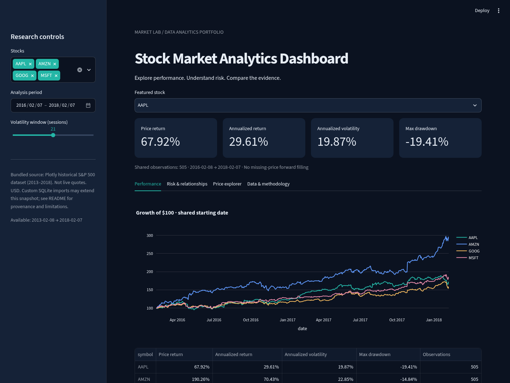

# Stock Market Analytics Dashboard

Compare historical equity performance and risk with an interactive Python dashboard.
SQLite stores validated daily OHLCV observations; SQL window functions compute
close-to-close returns; pandas and NumPy calculate portfolio research metrics;
Plotly provides zoomable charts in Streamlit.



## Quick start

Requires Python 3.11 or 3.12. From the repository root:

```bash
cd stock-market-dashboard
python -m venv .venv
source .venv/bin/activate
# Windows PowerShell: .venv\Scripts\Activate.ps1
python -m pip install -r requirements.txt
streamlit run app.py
```

Open http://localhost:8501 on the computer running Streamlit. This local URL
will not open the app from a separate iPad. Use Community Cloud below for an HTTPS link.
Both repository-root and project-folder launches include Streamlit theme configuration. The first launch creates `data/market.sqlite`
from the bundled real historical CSV. No API key or network connection is needed
after dependency installation. The database is local and excluded from Git.

For the exact dependency versions validated on Python 3.12/Linux, install
`requirements-lock.txt` instead. The lock includes development tools. The ranges
in `requirements.txt` support normal installations; the lock is the reproducibility reference.

## Deploy to Streamlit Community Cloud (including iPad Safari)

Use these exact settings when creating an app at https://share.streamlit.io/:

| Setting | Value |
| --- | --- |
| Repository | `patelkavitarepo/Data-analytics-portfolio` |
| Branch | `feat/stock-market-dashboard` |
| Main file path | `stock-market-dashboard/app.py` |
| Python version (Advanced settings) | `3.12` |
| Secrets | None required |

1. Sign in to Streamlit Community Cloud with GitHub and authorize access to this repository.
2. Choose **Create app** (or **New app**), then deploy from an existing GitHub repository.
3. Enter the repository, feature branch, and main file path above. Select Python 3.12 in Advanced settings and deploy.
4. Wait for the build to finish. Open the HTTPS `https://<your-app-name>.streamlit.app` URL shown by Streamlit in Safari on your iPad. This placeholder is not an already deployed address.
5. For an app intended for anyone with the link, check its sharing/access settings. A restricted app requires viewers to sign in. On a narrow screen, expand the sidebar with the top-left arrow to access stock and date filters. Rotate the iPad to landscape for wider charts.

The branch can be deployed before the pull request is merged. Community Cloud
tracks the selected branch; later pushes to it update that deployment. No merge
is needed for this setup. After an approved merge, you can configure a deployment
against `main` instead.

### Hosted environment behavior

- Root `requirements.txt` references the runtime requirements beside `app.py`;
  both supported dependency discovery locations use the same package list.
  No system packages, API keys, browser automation packages, or external data
  download are required for the running app.
- Imports resolve from the app's script directory. CSV and SQLite paths use
  `Path(__file__).resolve().parent`, independent of the working directory.
- `data/history.csv` and `data/provenance.json` are tracked in Git. On a fresh
  instance, the app validates the bundled CSV and creates `data/market.sqlite`.
  The generated database is intentionally not committed.
- The hosted filesystem is ephemeral. Reboots/redeployments can remove local
  SQLite changes; the bundled data is automatically restored. This application
  is a shared, read-only dashboard after initialization, not durable multi-user
  data storage. Commit any intended dataset updates through review.
- Root `.streamlit/config.toml` supplies the hosted theme and disables telemetry.
  The matching project config supports local launches. Keep these files in sync.
- Do not publish a fixed local port or localhost URL. Community Cloud manages
  routing, HTTPS, and WebSocket connections for the browser.

To simulate the hosted command from the repository root:

```bash
python -m pip install -r requirements.txt
python -m streamlit run stock-market-dashboard/app.py --server.headless true
```

The project is prepared for deployment; signing in and pressing Deploy creates
the actual public/restricted URL. Local Chromium checks are not a physical-device
Safari test. Verify the deployed URL on your iPad after the first deployment.

## Explore the dashboard

1. Select one or more of AAPL, AMZN, GOOG, and MSFT in the sidebar.
2. Choose a date range and a 10-, 21-, or 63-session volatility window.
3. Choose a featured stock for the four headline metrics.
4. **Performance:** compare growth of $100 and the summary statistics.
5. **Risk & relationships:** inspect peak losses, rolling volatility, and return correlations.
6. **Price explorer:** zoom and pan candlesticks and inspect trading volume.
7. **Data & methodology:** examine and download the filtered observations.

Empty selections, incomplete date ranges, and insufficient shared observations
produce explanatory messages. Hover charts to inspect values; use Plotly's
built-in zoom, reset, and image export controls.

## Real data and provenance

The checked-in `data/history.csv` contains **4,752 actual historical observations**:

| Symbol | First date | Last date | Rows |
| --- | --- | --- | ---: |
| AAPL | 2013-02-08 | 2018-02-07 | 1,259 |
| AMZN | 2013-02-08 | 2018-02-07 | 1,259 |
| GOOG | 2014-03-27 | 2018-02-07 | 975 |
| MSFT | 2013-02-08 | 2018-02-07 | 1,259 |

Source: Plotly's public [`all_stocks_5yr.csv`](https://github.com/plotly/datasets/blob/0c447c47b757ad74edecab31f0d72f849d2e67c2/all_stocks_5yr.csv),
pinned to commit `0c447c47b757ad74edecab31f0d72f849d2e67c2`.
Retrieved November 9, 2026. `data/provenance.json` records the source URL,
retrieval timestamp, SHA-256 checksums for both the original and filtered files,
coverage, and exact transformation. The only transformations are filtering four
symbols, renaming `Name` to `symbol`, and CSV serialization. Prices are unchanged.
The dataset is historical, **not current or live market data**.

To reproduce the bundled CSV from the network and verify its checksum:

```bash
python -m market.download
python -m market.ingest
```

The download command retrieves approximately 29 MB over verified HTTPS and refuses
to overwrite the CSV on a checksum mismatch. It intentionally reproduces the
pinned historical snapshot; it does not fetch today's prices. The upstream
repository describes its data as public datasets; it does not establish an
exchange redistribution license for these observations. Review upstream terms
before commercial redistribution.

### Import your own real data

```bash
python -m market.ingest --csv /path/to/actual-market-data.csv
```

Required columns: `date,open,high,low,close,volume,symbol`. Dates must be ISO dates;
prices must be finite and positive; volume must be nonnegative; OHLC ranges must
be consistent. Duplicate symbol/date keys within an import are rejected. Existing
keys in SQLite are updated transactionally, making repeated imports idempotent.
Use prices in a consistent currency and adjustment convention across symbols.
Record provenance for imported datasets yourself; the bundled provenance manifest
only describes `history.csv`. To rebuild only the bundled dataset, stop the app,
remove `data/market.sqlite`, then run `python -m market.ingest`.

## Methodology

All comparison metrics use the intersection of observed dates for the selected
symbols inside the selected range. Prices are never forward-filled. GOOG's later
start can shorten comparisons. All metrics use the first and last actual shared
observations, not the requested calendar boundaries. This means selecting another
stock can change a comparison's effective period. There must be at least three
shared observations. Missing shared sessions may make consecutive returns span
more than one exchange session; no trading-calendar reconstruction is attempted.

| Metric | Definition |
| --- | --- |
| Simple return | `close[t] / close[t-1] - 1` |
| Price return | `last close / first close - 1` |
| Growth of $100 | `100 × close[t] / first close` |
| Annualized return | `(last / first) ** (365.25 / elapsed calendar days) - 1` |
| Annualized volatility | sample standard deviation of returns × `sqrt(252)` |
| Rolling volatility | same calculation within the selected session window |
| Drawdown | `close[t] / max(close[0:t]) - 1` |
| Maximum drawdown | minimum drawdown in the selected period |
| Correlation | Pearson correlation of shared-date simple returns |

Rolling volatility remains undefined until a full window exists; constant-return
series can have undefined correlation. Annualizing very short samples is unstable.
The 252-session factor assumes typical US trading frequency. Drawdowns reset their
peak at the selected window's start, so earlier peaks are excluded.

The source does not verify corporate-action adjustment conventions. Results are
**price-based**, not dividend-reinvested total returns. Splits, dividends, and
other corporate actions can distort comparisons if prices are not consistently
adjusted. This project does not compute risk-free excess returns or claim a
tradable strategy. Historical performance is educational evidence, not a forecast.

## Architecture and SQL

```text
data/history.csv → validation → SQLite prices table
                                  ↓ SQL LAG window / date-symbol filters
                              pandas analysis
                                  ↓
                         Streamlit + Plotly charts
```

- `app.py`: interactive controls, charts, explanatory states, CSV export.
- `market/store.py`: validation, transactional upserts, parameterized SQL, and connection lifecycle.
- `market/analytics.py`: shared-date alignment and pure statistical calculations.
- `market/ingest.py`: CSV ingestion CLI.
- `market/download.py`: pinned, checksum-verified snapshot reproduction.
- `data/provenance.json`: source and transformation audit record.
- `tests/test_project.py`: formula, storage, validation, real-data, and UI checks.

The primary key is `(symbol, date)`. The `daily_returns` view uses:

```sql
SELECT *,
       close / LAG(close) OVER (PARTITION BY symbol ORDER BY date) - 1 AS daily_return
FROM prices;
```

The view computes returns before applying date filters, so its first filtered
row may reference the preceding stored observation outside the selected range.
Dashboard analytics recalculate returns after aligning and filtering to avoid
including that external return in period risk metrics. Query symbols and dates
are bound parameters, including when querying user-imported symbols.

## Tests and validation

```bash
python -m pip install -r requirements-dev.txt
python -m pytest -q
```

Tests cover hand-calculated returns, volatility and drawdowns, normalization,
rolling warmup, missing-date alignment, short periods, SQL round trips, idempotent
upserts, bound parameters, invalid prices/dates/OHLC/duplicates, real snapshot
validation, and Streamlit control interaction. Synthetic fixtures are explicitly
labeled test cases and are never displayed as real market observations.
GitHub Actions runs this suite on Python 3.11 and 3.12; remote CI results must be
checked independently from local results.

For a browser smoke test, start the app, install Chromium using
`python -m playwright install chromium`, then run:

```bash
python tests/browser_smoke.py
# Or use an installed browser:
CHROMIUM_EXECUTABLE=/usr/bin/chromium python tests/browser_smoke.py
```

The browser test checks rendered tabs, headline metrics, download controls,
mobile viewport rendering, and JavaScript errors. Local validation details are
recorded in `VALIDATION.md`.

## Troubleshooting

- **Module not found:** activate the virtual environment and install requirements.
- **Wrong theme:** run Streamlit from `stock-market-dashboard`, then restart it.
- **No common data:** broaden the date range or reduce the selected stocks.
- **Database error:** stop the app, back up custom data, remove the generated SQLite
  file, and reload the documented CSV. Do not remove a database containing your
  only copy of custom observations.
- **Download failure:** the bundled CSV still works offline; verify access to
  `raw.githubusercontent.com`. TLS verification is never disabled.
- **Port occupied:** use `streamlit run app.py --server.port 8502`.
